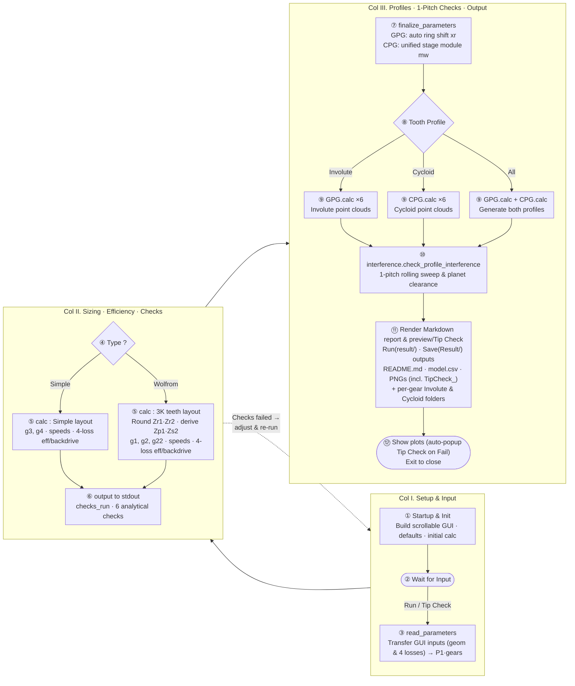
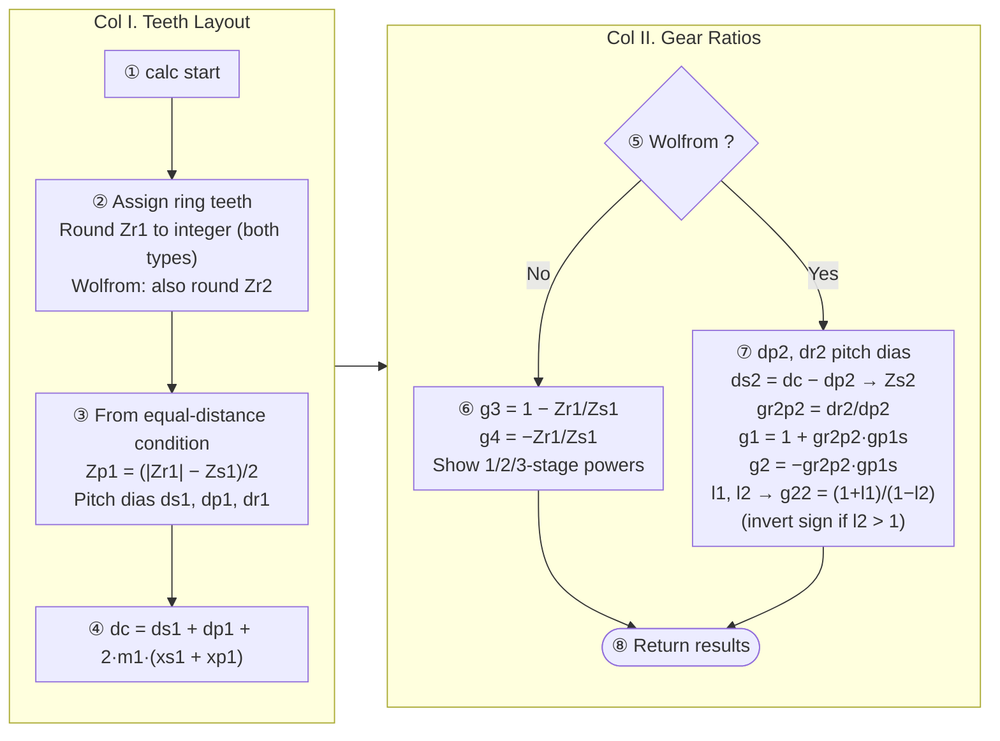
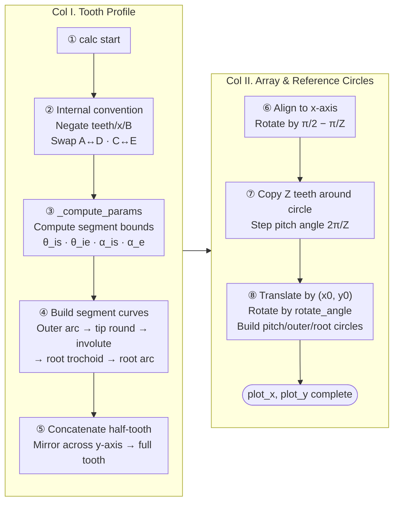

# PGS User Manual — 3K Wolfrom Gearbox Configuration and Design

_PGS (Planetary Gear Set Sizing Tool) — Sizing Tool for Simple & Wolfrom Planetary Gear Sets_

* [한국어 매뉴얼 (MANUAL_KO.md)](MANUAL_KO.md) | [README.md](README.md)

Based on the `PGS.py`, `GPG.py`, `CPG.py`, `interference.py`, and `design.py` source code, this manual explains the configuration and design workflow for a **3K-type Wolfrom Planetary Gear Set (Wolfrom Gearbox)**, its core algorithms and theory, and the program flowcharts.

---

## Table of Contents

1. [Program Overview and Gear Train Architecture](#1-program-overview-and-gear-train-architecture)
2. [3K Wolfrom Gearbox Configuration and Design Workflow](#2-3k-wolfrom-gearbox-configuration-and-design-workflow)
3. [Core Algorithms and Theory](#3-core-algorithms-and-theory)
4. [Flowcharts](#4-flowcharts)
5. [Pre-Optimization Search Tool (PRE-OPT_3K-WOLFROM)](#5-pre-optimization-search-tool--pre-opt_3k-wolfrompy)

---

## 1. Program Overview and Gear Train Architecture

### 1.1 File Structure

| File | Role |
|------|------|
| `design.py` | GUI entry point (Tkinter/ttk input interface, Run/Tip Check/Load/Save handlers, matplotlib drawing/preview, Markdown-rendered Result panel, report/PNG/per-gear CSV and FGPG2 output) |
| `PGS.py` | Planetary gear sizing calculator (teeth layout solver, gear ratios, operating speeds, efficiency/backdrivability, geometric feasibility checks) |
| `GPG.py` | Involute tooth profile generator (shared by external and internal gears) |
| `CPG.py` | Cycloidal tooth profile generator (drop-in replacement sharing the `GPG` interface) |
| `interference.py` | Kinematic 1-pitch rolling-sweep tip-interference verifier and zoomed worst-phase plotter (shared by Involute and Cycloid profiles) |
| `FGPG2_CLI.py` | Bundled FGPG2 CLI entry point (`FGPG2_CLI.py <Inputs.csv> [involute\|cycloid]`) — regenerates per-gear Result files |
| `PGS_CLI.py` | Command-line (headless) runner — reads `## Input Parameters` from a `.md` report, performs the same calculation as the GUI, and exports result files according to `SaveAll`/`SaveOK`/`SaveMD` (§2.9) |
| `fgpg2/` | Ported FGPG2 tooth generation package (`gear.py`, `cycloid.py`, `exporters.py`, `plotter.py`) — generates `Result.csv`/`Result.dxf`/`Result1.png`/`Result2.png` in-process on Save/Run |
| `PGS.bat` / `PGS.sh` | OS-specific launcher scripts |
| `PRE-OPT_3K-WOLFROM.py` | Pre-optimization search GUI — scans a 3K-Wolfrom parameter space, lists geometrically feasible combinations in a table, exports to `Result.xlsx`, and opens a selected combination in `design.py` (§5) |
| `PRE-OPT_3K-WOLFROM.bat` / `PRE-OPT_3K-WOLFROM.sh` | Dedicated launcher scripts for PRE-OPT |

### 1.2 Architecture of the Wolfrom (3K) Planetary Gear Set

The 3K-type Wolfrom gearbox modeled by this program is a **two-stage planetary gear set sharing a single carrier**, consisting of six gears in total:

```
             ┌─────────────── Stage 1 (Module m1) ───────────────┐
   Input ⊙── Gs1 (Sun, Zs1) ── Gp1 (Planet, Zp1) ── Gr1 (Ring, Zr1, Fixed)
                         │
                    Carrier (Gp1 and Gp2 rigidly coupled at radius dc/2)
                         │
             ┌─────────────── Stage 2 (Module m2) ───────────────┐
              Gs2 (Sun, Zs2) ── Gp2 (Planet, Zp2) ── Gr2 (Ring, Zr2, Output)
```

- **Stage 1**: Sun gear `Gs1` ↔ Planet gear `Gp1` (external mesh), `Gp1` ↔ Ring gear `Gr1` (internal mesh), module `m1`
- **Stage 2**: Sun gear `Gs2` ↔ Planet gear `Gp2` (external mesh), `Gp2` ↔ Ring gear `Gr2` (internal mesh), module `m2`
- **Compound planet coupling**: `Gp1` and `Gp2` have different diameters while rigidly joined on the same shaft at the carrier radius `dc/2`.
- **3K operation**: Sun gear `Gs1` (input) — Ring gear `Gr1` (fixed) — Ring gear `Gr2` (output). The carrier transmits no external torque and only supports the planet axes ("Type-3K : Carrier Free").

### 1.3 Gear Type Codes

| Type Code | Meaning |
|-----------|---------|
| 0 | Simple (standard single-stage planetary gear set) |
| 1 | 3K-Wolfrom (reduction ratio tuned by the tooth-count difference between the two ring gears) |

The ring tooth-count difference $|\,|Z_{r1}| - |Z_{r2}|\,|$ is determined by the two independent inputs ($Z_{r1}$, $Z_{r2}$) and governs the magnitude of the reduction ratio (see §3.2 and §3.4-c).

---

## 2. 3K Wolfrom Gearbox Configuration and Design Workflow

### 2.1 Step 0 — Launching

```bash
uv sync            # First time only: install dependencies
uv run design.py   # Launch GUI (or Windows: PGS.bat / Linux: ./PGS.sh)
uv run design.py Result/README.md   # Report path argument → auto-fill parameters at startup and run immediately
uv run PRE-OPT_3K-WOLFROM.py  # Pre-optimization search (§5; Windows: PRE-OPT_3K-WOLFROM.bat / Linux: ./PRE-OPT_3K-WOLFROM.sh)
```

### 2.2 Step 1 — Translating Target Ratio into Type and Ring Teeth (Zr1 · Zr2)

The 3K reduction ratio takes the approximate form $i_{3K} \approx \dfrac{Z_{r1}/Z_{s1}}{1 - \dfrac{Z_{r1} Z_{p2}}{Z_{r2} Z_{p1}}}$; the smaller the tooth-count difference $|\,|Z_{r1}| - |Z_{r2}|\,|$ (making $l_2$ closer to 1), the higher the reduction ratio.

- Select `Simple` or `3K-Wolfrom` in the **Type combobox**.
- The two ring tooth counts `Ring1 Teeth, Zr1` and `Ring2 Teeth, Zr2` are **independent input variables** entered directly for stage 1 and stage 2 (§3.2).
- When `3K-Wolfrom` is selected, `Ring2 Teeth, Zr2` is shown directly below `Planet2 Teeth, Zp2`.
- When `Simple` is selected, stage-2 inputs (`Module2, m2`, `Shift factor, Gp2.X`, `Ring2 Teeth, Zr2`, `Planet2 Teeth, Zp2`) and `Carrier bearing, μb_c` are hidden or disabled, and Plot options offer only stage-1 views (`Stage1`/`Gs1`/`Gp1`/`Gr1`).
- Adjust $Z_{r2}$ together with $Z_{r1}$ so that a smaller difference yields a higher ratio and a larger difference yields a lower ratio.
- The GUI defaults are `3K-Wolfrom` with `Zr1 = 90.0` and `Zr2 = 54.0` (with $m_1=0.8$, $m_2=1.2$, $N_p=3$, $Z_{p2}=20$, $Z_{s1}=12$, giving a Type-3K ratio of 58.5).

### 2.3 Step 2 — Independent Design Variables ("Planetary System" Card)

A 3K-Wolfrom system has exactly 7 independent geometric design variables ($m_1$, $m_2$, $N_p$, $Z_{r1}$, $Z_{r2}$, $Z_{p2}$, $Z_{s1}$). The remaining tooth counts (`Zp1`, `Zs2`) and diameters are derived automatically. **Simple** has only stage 1, so `Zr2`/`Zp2` are hidden and `m2`/`Gp2.X` are disabled.

| Input Field | Symbol | Meaning / Selection Guideline |
|-------------|--------|-------------------------------|
| Planet number, Np | $N_p$ | Number of planets [ea], > 2 (must satisfy equal-spacing / assembly condition) |
| Module1, m1 | $m_1$ | Stage-1 module [mm], > 0 |
| Module2, m2 | $m_2$ | Stage-2 module [mm]; typically $m_2 > m_1$ |
| Sun1 Teeth, Zs1 | $Z_{s1}$ | Stage-1 sun gear teeth [ea] — **directly affects gear ratio** |
| Ring1 Teeth, Zr1 | $Z_{r1}$ | Stage-1 ring gear teeth [ea] — **direct input** (both Simple and Wolfrom) |
| Planet2 Teeth, Zp2 | $Z_{p2}$ | Stage-2 planet gear teeth [ea] — **direct input (3K-Wolfrom only)** |
| Ring2 Teeth, Zr2 | $Z_{r2}$ | Stage-2 ring gear teeth [ea] — **direct input (3K-Wolfrom only)** |
| Input speed, ns1 | $n_{s1}$ | Input rotational speed of sun gear `Gs1` [rpm] — **used in the Speed blocks (§3.4-e·f) and churning loss (§3.8)** |

> UI field order: **Type → Planet number Np → Module1 m1 → Module2 m2 → Sun1 Zs1 → Ring1 Zr1 → Planet2 Zp2 → Ring2 Zr2 → Input speed ns1**.

### 2.4 Step 3 — Tooth Profile and Loss Parameters

**"Involute Gear Spec" Card:**

| Input Field | Symbol | Meaning |
|-------------|--------|---------|
| Shift factor, Gs1.X | $x_{s1}$ | Stage-1 sun gear profile shift coefficient; determines carrier radius together with `Gp1.X` |
| Shift factor, Gp1.X | $x_{p1}$ | Stage-1 planet gear profile shift coefficient |
| Shift factor, Gp2.X | $x_{p2}$ | Stage-2 planet gear profile shift coefficient (automatically sets $x_{s2}=-x_{p2}$ for stage-2 external mesh) |
| Backlash factor, B | $B$ | Backlash factor (tooth thinning amount, applied as $\times m$) |
| Addendum factor, A | $A$ | Addendum coefficient |
| Dedendum factor, D | $D$ | Dedendum coefficient |
| Pressure angle, α | $\alpha_0$ | Pressure angle [deg] (analytical interference checks apply only at standard 20°) |
| Hob end radius, C | $C$ | Hob tip corner radius factor [mm] (root fillet geometry) |
| Tooth end radius, E | $E$ | Tooth tip rounding radius factor [mm] |

**"Loss Parameters" Card** — All 7 inputs are editable comboboxes supporting preset selection or any custom non-negative number (enter `0` to exclude a loss term; bearing losses are separated into four independent groups with geometry-derived leverage factors $k$):

| Input Field | Symbol | Presets (Default) | Meaning |
|-------------|--------|-------------------|---------|
| Friction coeff, μ | $\mu$ | `0.08 (Grease)` (default), `0.05 (Oil)` | Tooth-mesh sliding friction coefficient |
| Input bearing, μb_in | $\mu_{b,\text{in}}$ | `0.002 (Ball)` (default), `0.005 (Roller)`, `0.05 (Bushing)`, `0.0 (Floating/None)` | Input shaft (`Gs1`) support bearing friction coefficient ($k_{\text{in}} = d_{b,\text{in}}/d_{s1}$) |
| Planet bearing, μb_p | $\mu_{b,p}$ | `0.002 (Ball/Needle)` (default), `0.005 (Roller)`, `0.05 (Bushing)`, `0.0 (None)` | Planet pin bearing friction coefficient inside the carrier power-circulation loop ($d_{\text{pin}}/d_p$) |
| Carrier bearing, μb_c | $\mu_{b,c}$ | `0.002 (Ball)` (default), `0.005 (Roller)`, `0.05 (Bushing)`, `0.0 (Floating/None)` | Free-rotating carrier support bearing friction coefficient for Wolfrom Type-3K ($k_c = d_c/(d_{s1}+d_{r1})$; disabled in Simple mode, 0 when Carrier Fixed, merged into Output Shaft Bearing when Carrier Output to prevent double-counting) |
| Output bearing, μb_out | $\mu_{b,\text{out}}$ | `0.005 (Crossed Roller)` (default), `0.002 (Ball)`, `0.01 (Preloaded CRB)`, `0.05 (Bushing)`, `0.0 (None)` | Output shaft/housing bearing friction coefficient (Ring output: $k_{\text{out}} = (d_{r,\text{out}}+4m_{\text{out}})/d_{r,\text{out}}$; Carrier output: $k_{\text{out}} = 0.5(d_{s1}+d_c)/d_c$, applied once) |
| Seal loss, ζs | $\zeta_s$ | `0.0 (None)` (default), `0.005 (Low-fric)`, `0.01 (Lip seal)`, `0.02 (Double-lip)` | Load-independent input/output shaft seal drag fraction |
| Churning coeff, kc | $k_c$ | `0.005 (Grease)` (default), `0.015 (Oil splash)`, `0.002 (Oil mist)`, `0.0 (None)` | Reference lubricant churning loss fraction at `1000 rpm`, scaled with input speed $n_{s1}$ ($\propto (|n_{s1}|/1000)^2$) |

> **GUI Scrollbar, Markdown View, Copy & Search**: The left input sidebar (`Planetary System`, `Involute Gear Spec`, `Loss Parameters`, `Plot`) supports vertical scrollbar and mouse-wheel scrolling, opening at a compact default height (~70% of the full stacked height). The right **Result** panel renders the report as formatted Markdown and provides a **Copy** button (copies raw Markdown source to the clipboard) and a **Search** box (`Ctrl+F` shortcut, `Enter`/`Shift+Enter` or `▲`/`▼` navigation, `Esc`/`×` clear) to immediately highlight and jump to keywords.

**Note — Ring gear profile shift factors ($x_{r1}, x_{r2}$) are not user inputs.**
The program automatically computes both ring shift factors so that each internal mesh achieves zero-backlash flank contact at the carrier radius (§3.5). The input backlash $B$ then acts cleanly as flank clearance on top of this zero-backlash baseline.

### 2.5 Step 4 — Plot Option and Tooth Profile Selection

**Plot option** — Controls the scope of the interactive preview window:

- Single gear: `Gs1` / `Gp1` / `Gr1` (stage 1), `Gp2` / `Gr2` (stage 2, Wolfrom only)
- Assembly scope: `Stage1` (stage 1 only) / `Stage2` (stage 2 only, **Wolfrom only**) / `Total` (stage 1 + stage 2 overlay)
- Simple mode provides only stage-1 options (`Stage1` / `Gs1` / `Gp1` / `Gr1`).
- When plotting planet gears (`Gp1`, `Gp2`), all `Np` planets are arrayed around the carrier circle. Each $i$-th planet ($\phi_i = 2\pi i / N_p$) is pre-rotated around its own center by its meshing self-spin angle ($\beta_{p1,i} = +(Z_{s1}/Z_{p1})\phi_i$, $\beta_{p2,i} = -(|Z_{r2}|/Z_{p2})\phi_i$) before orbiting, so every planet aligns accurately with the sun and ring gears even in non-factorizing (sequential-mesh) designs (§3.9).

Color scheme: Stage-1 gears use **light/medium tones** (Involute = `dimgray`, Cycloid = `#95c4ed`); Stage-2 gears use **dark tones** (Involute = `black`, Cycloid = `#19609d`).

**Teeth profile** — Selects the tooth profile generator:

- `Involute Teeth` (`GPG`) or `Cycloid Teeth` (`CPG`) individually
- **`All`** — **Overlays both Involute and Cycloid profiles simultaneously** in distinct colors for direct visual comparison under any Plot option.

> **Note — Saved drawing files**: Regardless of `Plot option`, saving always exports drawings for every applicable scope. See the output file list in §2.6.

### 2.6 Step 5 — Run · Tip Check · Load · Save Buttons

Pressing **Run** executes the full calculation, saves all generated files into the project's `result/` directory, renders the saved `result/README.md` (with linked images) in the Result panel, and displays the interactive preview:

1. `read_parameters()` — Transfers GUI input values to the model objects
2. `PGS.calc()` — Computes teeth layout, pitch diameters, ratios, operating speeds, and efficiency/backdrivability (§3.2–3.4, §3.8)
3. `PGS.output()` — Prints ratios, speeds, efficiency, and sizes to stdout
4. `PGS.checks_run()` — Executes the 6 analytical geometric feasibility checks (§3.6)
5. `finalize_parameters()` — Computes automatic ring profile shifts (`GPG`) or operating-module pitch radii (`CPG`) (§3.5, §3.7)
6. Per-gear `GPG.calc()` / `CPG.calc()` — Generates tooth contour point clouds for 6 gears (or 3 for Simple) (§3.7)
7. `interference.check_profile_interference()` — Performs the 1-pitch rolling-sweep tip interference check across `Gs1-Gp1`, `Gp1-Gr1`, `Gp2-Gr2` (Wolfrom) and planet-to-planet tip clearance check for the active profile(s)
8. `_save_and_show_result("result/")` — Writes all outputs into `result/` and renders the saved `result/README.md` (with linked `Cycloid_*.png` and `Involute_*.png` images) in the Result panel
9. `plot_pgs()` — Opens the interactive preview for the selected Plot option; if any kinematic tip interference check fails (`Fail`), automatically opens the zoomed worst-phase inspection window with interfering points marked in red

**Tip Check** runs the calculation and opens the zoomed worst-phase tip-interference inspection window immediately for all active profiles (`Involute`, `Cycloid`, or both for `All`), even when every check passes (`OK`). Both **Run** and **Save** also always export `TipCheck_Involute.png` and `TipCheck_Cycloid.png` regardless of pass/fail status.

**Load** opens a file picker for a saved `README.md` (e.g. `Result/README.md`), reads its `## Input Parameters` section to refill every input widget, and then runs the exact same workflow as **Run** so a previously saved design can be reopened and iterated on immediately.

> - If the chosen file has no `## Input Parameters` section, a warning dialog appears and nothing changes.
> - Ring tooth counts stored negative in the report (`-90.0`) are automatically converted back to positive numbers (`90.0`) for the input boxes.
> - Legacy reports containing only a single `mu_b` key remain backward-compatible and automatically populate all four separated bearing fields (`mu_b_in`, `mu_b_p`, `mu_b_c`, `mu_b_out`).

**Save** opens a folder picker, creates a `Result/` subdirectory inside the chosen folder, re-runs the calculation, and writes every output file (the Save button is disabled while exporting and re-enabled on completion):

- `Result/README.md` — Complete Markdown report (same source rendered in the Result panel)
- `Result/model.csv` — Gearbox input-model table summarizing gear, carrier, shaft, and frame dimensions
- `Result/Involute_*.png`, `Result/Cycloid_*.png`, `Result/All_*.png` — **Tooth profile drawings for all scopes**
  - Naming convention: `{Involute|Cycloid}_` prefix + scope (`Stage1`/`Stage2`/`Total` or gear name `Gs1`/`Gp1`/`Gr1`/`Gp2`/`Gr2`)
  - `All_*` overlays both profiles for the full assembly and each individual gear: 6 files for 3K-Wolfrom (`All_Total`, `All_Gs1`, `All_Gp1`, `All_Gr1`, `All_Gp2`, `All_Gr2`) and 4 files for Simple (`All_Stage1`, `All_Gs1`, `All_Gp1`, `All_Gr1`)
  - Total profile drawings: **22 PNGs** for 3K-Wolfrom (8 Involute + 8 Cycloid + 6 All) and **12 PNGs** for Simple (4 + 4 + 4)
  - If cycloid geometry cannot be generated (e.g. fractional $Z_{s2}$), a `WARN` message is printed and only the Cycloid/All drawings are skipped (Involute drawings, report, and per-gear outputs are still written).
- `Result/TipCheck_Involute.png`, `Result/TipCheck_Cycloid.png` — Zoomed worst-phase kinematic 1-pitch tip-interference inspection plots (always saved regardless of pass/fail; `TipCheck_Cycloid.png` omitted only if cycloid generation fails)
- `Result/<Gear>/Inputs.csv` — Per-gear input parameters (`Gs1`, `Gp1`, `Gr1`, plus `Gp2`, `Gr2` for Wolfrom; `Gs2` is never exported)
- `Result/<Gear>/{Involute,Cycloid}/` — Per-profile FGPG2 outputs
  - `Inputs.csv` + `Result.csv` (tooth coordinates) + `Result.dxf` (CAD drawing) + `Result1.png` (full gear view) + `Result2.png` (single tooth view) — generated in-process via `FGPG2_CLI.py <csv> [involute|cycloid]`

### 2.7 Step 6 — Reviewing Results and Iterating

Review the following sections in the Result panel (and saved `README.md`). For long reports, use the **Search:** box at the top right of the Result panel (`Ctrl+F` to focus, real-time case-insensitive highlight with match counter, `Enter`/`▼` next, `Shift+Enter`/`▲` previous, `Esc`/`×` clear, automatic re-search on Run) and the **Copy** button to copy the raw Markdown source:

- **Check Geometrical Conditions** — Iterate Steps 2–4 until all 6 analytical stage-1 checks and all kinematic 1-pitch tip-interference checks (`Kinematic Tip Interference [...]`) pass (`OK`).
  - Typical adjustments on failure: `Equal Distance` fail → adjust $Z_{s1}, Z_{r1}, N_p$ / `Planets Interference` fail → reduce $N_p$ or planet teeth $Z_{p1}=(|Z_{r1}|-Z_{s1})/2$ / `Trimming Interference` fail → increase ring–planet tooth difference so $|Z_{r1}|-Z_{p1} \ge 16$ / `Kinematic Tip Interference` fail → inspect the red interference markers in the `Tip Check` zoomed plot and adjust $A, D, C, B$ or tooth counts/profile shifts.
- **Ratio** — Per-stage and total gear ratios (§3.4)
- **Speed** — Operating speeds by lockup configuration (3 configs for Wolfrom §3.4-e, 2 configs for Simple §3.4-f)
- **Efficiency & Backdrivability** — Combined 4-loss breakdown ($\mu$, separated bearings $\mu_{b,\text{in}}/\mu_{b,p}/\mu_{b,c}/\mu_{b,\text{out}}$ with leverage factors $k$ and effective diameters $d_b$, seal $\zeta_s$, speed-dependent churning $k_c$ at $n_{s1}$), forward ($\eta_F$) and reverse ($\eta_R$) total efficiencies, 3-tier backdrivability assessment (`Good` / `Marginal` / `Self-Locking`, plus critical self-locking friction coefficient $\mu_{\text{lock}}$ for Type-3K), and 2-tier conclusion (`Possible` / `Not Possible`) (§3.8)
- **Size** — Pitch circle diameters, tooth counts, and carrier radius (stage 1 only for Simple)
- **Per-gear specs (`### Gs1`, `Gp1`, `Gr1`, `Gp2`, `Gr2`)** — Detailed tooth geometry values for CAD/drawing (the virtual stage-2 sun `Gs2` is omitted)

**Note**: The stage-2 sun tooth count $Z_{s2}$ is derived from the shared carrier radius and may be non-integer (e.g. `15.066667`). It is a geometric reference value in the model and is not exported as a physical gear.

### 2.8 One-Page Workflow Summary

```
Choose target ratio → Select Type → Enter (Np, m1, m2, Zs1, Zr1, plus Zp2, Zr2 for Wolfrom, and ns1)
→ Enter shift, backlash, tooth factors & loss parameters (μ, μb_in/p/c/out, ζs, kc) → Run (computes, saves to result/ & previews)
→ Auto-computed: teeth layout (Zp1, Zs2), ratios, speeds, efficiency/backdrivability, ring shifts, profiles, 1-pitch tip checks
→ Verify 6 analytical checks + kinematic tip checks (use Tip Check for zoomed inspection) → adjust & re-run if needed
→ Once all OK, press Save → creates Result/ in chosen folder (README.md, model.csv, all PNGs incl. TipCheck_, per-gear CSV/DXF/PNG)
→ Later, use Load to pick a saved Result/README.md → auto-refills all inputs
→ For headless batch re-run/export, use PGS_CLI.py <README.md> [SaveAll|SaveOK|SaveMD] (§2.9)
```

### 2.9 Command-Line (CLI) Execution — `PGS_CLI.py`

You can execute the exact same calculation and export pipeline headlessly without launching the GUI:

```bash
uv run PGS_CLI.py <README.md> [SaveAll|SaveOK|SaveMD]
```

- `<README.md>` — Path to a Markdown file containing `## Input Parameters` (e.g. `Result/README.md`). Reads Type, teeth, shifts, backlash, and loss parameters and performs the same calculation as GUI **Run**.
- `SaveAll` (default when omitted) — Saves `README.md`, `Involute_*/Cycloid_*/All_*.png`, `TipCheck_*.png`, and per-gear folders (`Gs1`/`Gp1`/`Gr1`[`/Gp2`/`Gr2`] with `Involute`/`Cycloid` subfolders) in the **same directory as the input file**, identical to GUI **Save**.
- `SaveOK` — Writes nothing if any check in the regenerated `## Check Geometrical Conditions` contains `Fail`.
- `SaveMD` — Like `SaveOK`, writes nothing if any check is `Fail`; when every check is `OK`, writes **only `README.md`** (skipping PNGs and per-gear folders).
- Note: Because the report is written as `README.md` in the input file's directory, an input file already named `README.md` is overwritten with the regenerated report.

---

## 3. Core Algorithms and Theory

### 3.1 Nomenclature

| Symbol | Meaning | Symbol | Meaning |
|--------|---------|--------|---------|
| $Z_{s1}, Z_{p1}, Z_{r1}$ | Stage-1 sun, planet, ring teeth ($Z_{r1}<0$: internal) | $m_1, m_2$ | Stage-1 and stage-2 modules |
| $Z_{s2}, Z_{p2}, Z_{r2}$ | Stage-2 sun, planet, ring teeth ($Z_{r2}<0$: internal) | $N_p$ | Number of planets |
| $d_{s}, d_{p}, d_{r}$ | Standard pitch circle diameters ($=mZ$) | $d_c$ | Carrier (orbit) diameter |
| $x$ | Profile shift coefficient | $\alpha_0$ | Pressure angle, $a_0=\alpha_0\,[\text{rad}]$ |
| $A, D, B, C, E$ | Addendum, dedendum, backlash, hob-tip, tooth-tip factors | $\mu, \mu_{\text{lock}}$ | Mesh friction coeff., critical self-locking friction coeff. |
| $\varepsilon_\alpha, H_v$ | Transverse contact ratio, tooth loss factor | $\eta_F, \eta_R$ | Forward and reverse expected efficiencies |
| $\mu_b, \zeta_s, k_c$ | Bearing friction, seal loss, churning loss (@1000 rpm) coeffs. | $d_{\text{pin}}, v_{t,s1}$ | Planet pin diameter [mm], sun pitch-line speed [m/s] |

### 3.2 Teeth Layout Solver — `PGS.calc()`

The two ring tooth counts $Z_{r1}$ and $Z_{r2}$ are **independent inputs** (rounded to whole numbers to guarantee integer ring teeth), from which the remaining tooth counts are determined.

**(1) Stage-1 Equal-Distance Condition** — For the planet centers to lie on the carrier circle:

```math
\begin{gathered}
|Z_{r1}| = Z_{s1} + 2Z_{p1}\\[6pt]
\Longrightarrow\quad Z_{p1} = \frac{|Z_{r1}| - Z_{s1}}{2}
\end{gathered}
```

Thus $Z_{p1}$ is determined automatically from $Z_{s1}$ and $Z_{r1}$.

**(2) Carrier Diameter** — The carrier diameter is determined by the operating center distance of the stage-1 external mesh (§3.3). The stage-2 ring gear meshes with planet 2 on this shared carrier; any mismatch between the input $Z_{r2}$ and the standard pitch circle is **absorbed by the automatic ring profile shift $x_{r2}$ (§3.5)**.

**(3) Stage-2 Sun Gear** — Derived from the shared carrier radius: $d_{s2} = d_c - d_{p2}$, $Z_{s2} = d_{s2}/m_2$.

> Internally, internal (ring) gears carry negative tooth counts: `self.zr1 = -floor(abs(zr1_input) + 0.5)`. Since both ring tooth counts are independent inputs, an arbitrary pair may violate assembly or interference conditions, which are flagged by §3.6.

### 3.3 Gear Diameters and Carrier

Standard pitch circle diameters:

```math
\begin{aligned}
d_{s1} &= m_1 Z_{s1},\\
d_{p1} &= m_1 Z_{p1},\\
d_{r1} &= m_1 |Z_{r1}|
\end{aligned}
```

The **carrier diameter** is computed from the operating center distance of the profile-shifted sun–planet external mesh (linear model):

```math
\boxed{
\begin{aligned}
d_c &= d_{s1} + d_{p1} + 2 m_1 (x_{s1} + x_{p1})\\
   &= m_1 (Z_{s1} + Z_{p1}) + 2 m_1 (x_{s1} + x_{p1})
\end{aligned}
}
```

That is, the carrier radius expands linearly by the shift sum $(x_{s1}+x_{p1})$, matching the offset circle radii $m\,(Z/2 + x)$ drawn by the profile generators (`GPG`/`CPG`).

For stage 2, planet 2 is fixed to the same carrier, determining the reference stage-2 sun:

```math
\begin{aligned}
d_{p2} &= m_2 Z_{p2}, & d_{s2} &= d_c - d_{p2},\\[2pt]
Z_{s2} &= \frac{d_{s2}}{m_2}, & d_{r2} &= m_2 |Z_{r2}|
\end{aligned}
```

### 3.4 Gear Ratios — Willis Kinematic Analysis

Speed relations are written in the carrier-fixed frame (Willis equations). External meshes counter-rotate while internal meshes co-rotate relative to the carrier. The program defines four core scalars:

```math
\begin{aligned}
g_{p1s} &= \frac{d_{p1}}{d_{s1}} = \frac{Z_{p1}}{Z_{s1}}, &&(\text{Sun1–Planet1})\\[2pt]
g_{r2p2} &= \frac{d_{r2}}{d_{p2}} = \frac{Z_{r2}}{Z_{p2}}, &&(\text{Planet2–Ring2})
\end{aligned}
```

```math
\begin{aligned}
l_1 &= \frac{d_{r1}}{d_{s1}} = \frac{Z_{r1}}{Z_{s1}},\\[2pt]
l_2 &= \frac{d_{r1}\,d_{p2}}{d_{r2}\,d_{p1}} = \frac{Z_{r1}\,Z_{p2}}{Z_{r2}\,Z_{p1}}
\end{aligned}
```

#### (a) Ring2 Fixed, Carrier Output ($i_1$) — `g1`

With Ring2 fixed, $n_{p1}-n_c = -\dfrac{Z_{r2}}{Z_{p2}} n_c$. Combining with the stage-1 external mesh $n_{p1}-n_c = -\dfrac{1}{g_{p1s}}(n_s - n_c)$ yields:

```math
\begin{gathered}
n_{s1} = \left(1 + g_{r2p2}\, g_{p1s}\right) n_c\\[4pt]
\boxed{i_1 = 1 + g_{r2p2}\, g_{p1s}}
\end{gathered}
```

#### (b) Carrier Fixed, Ring2 Output ($i_2$) — `g2`

With $n_c = 0$, applying the stage-1 external and stage-2 internal meshes in series gives:

```math
\begin{gathered}
\frac{n_{r2}}{n_{s1}} = -\frac{Z_{s1}}{Z_{p1}}\cdot\frac{Z_{p2}}{Z_{r2}}
= -\frac{1}{g_{p1s}\, g_{r2p2}}\\[4pt]
\boxed{i_2 = -\,g_{r2p2}\, g_{p1s}}
\end{gathered}
```

#### (c) Type-3K Operation: Carrier Free, Ring1 Fixed, Ring2 Output ($i_{3K}$) — `g22`

From the stage-1 internal mesh with Ring1 fixed ($n_{r1}=0$), $n_{p1}-n_c = -\dfrac{Z_{r1}}{Z_{p1}} n_c$.

Substituting into the stage-1 external mesh gives $n_{s1} = (1+l_1)\,n_c$.

From the stage-2 internal mesh, $n_{r2} = n_c + \dfrac{Z_{p2}}{Z_{r2}}\left(n_{p1}-n_c\right) = (1 - l_2)\, n_c$.

Eliminating $n_c$:

```math
\boxed{
\begin{gathered}
i_{3K} = \frac{n_{s1}}{n_{r2}} = \frac{1 + l_1}{1 - l_2},\\[4pt]
\big(\text{for } l_2 > 1,\ \text{direction reverses: } -\frac{1+l_1}{|1-l_2|}\big)
\end{gathered}
}
```

As $l_2 \to 1$, the reduction ratio diverges; thus **the ratio magnitude is tuned by bringing $l_2$ close to 1 through the ring tooth-count difference $|Z_{r1}| - |Z_{r2}|$** via the independent inputs $Z_{r1}$ and $Z_{r2}$. The result is also printed as a reduced fraction (e.g. `58.5 = 117/2`).

#### (d) Simple Type — `g3`, `g4`

```math
\begin{aligned}
i_{\text{carrier}} &= 1 - \frac{Z_{r1}}{Z_{s1}},\\[2pt]
i_{\text{ring}} &= -\frac{|Z_{r1}|}{Z_{s1}}
\end{aligned}
```

For multi-stage series trains, powers of the single-stage ratio (1-, 2-, and 3-stage) are displayed alongside.

#### (e) Operating Speeds [rpm] — 3 Wolfrom Speed Blocks (`n_*` attributes)

Given input speed $n_{s1}$ [rpm], the actual rotational speed of every element is computed for each of the three lockup configurations, signed `+/-` relative to `Gs1`:

**A. Type-3K : Carrier Free, Ring2 Output (Ring1 Fixed):**

```math
\boxed{
\begin{gathered}
n_c = \frac{n_{s1}}{1 + l_1},\\[2pt]
n_{p} = n_c\left(1 - \frac{|Z_{r1}|}{Z_{p1}}\right),\\[2pt]
n_{r1} = n_c + \frac{Z_{p1}}{|Z_{r1}|}\,(n_{p} - n_c) \equiv 0,\\[2pt]
n_{r2} = (1 - l_2)\, n_c
\end{gathered}
}
```

**B. Ring2 Fixed, Carrier Output (Ratio $g_1$):**

```math
\boxed{
\begin{gathered}
n_c = \frac{n_{s1}}{g_1},\\[2pt]
n_{p} = n_c\,(1 - g_{r2p2}),\\[2pt]
n_{r1} = n_c\left(1 - \frac{Z_{p1}}{|Z_{r1}|}\,g_{r2p2}\right),\\[2pt]
n_{r2} \equiv 0
\end{gathered}
}
```

**C. Carrier Fixed, Ring2 Output (Ratio $g_2$):**

```math
\boxed{
\begin{gathered}
n_c \equiv 0,\\[2pt]
n_{p} = -\frac{n_{s1}}{g_{p1s}},\\[2pt]
n_{r1} = \frac{Z_{p1}}{|Z_{r1}|}\,n_{p},\\[2pt]
n_{r2} = \frac{n_{p}}{g_{r2p2}} = \frac{n_{s1}}{g_2}
\end{gathered}
}
```

- **Compound planets (`Gp1`, `Gp2`)**: Because they walk around the ring gear, they rotate in the **opposite direction (−)** to the input in all three configurations A, B, and C.
- **Fixed member**: The grounded element (Ring1, Ring2, or Carrier) always evaluates to $+0$ [rpm], while unconstrained members (such as Ring1 in config B) idle freely.
- **Cross-check**: $n_{r2}=n_{s1}/i_{3K}$ (A), $n_c=n_{s1}/g_1$ (B), and $n_{r2}=n_{s1}/g_2$ (C) automatically match the gear ratio definitions and satisfy all three Willis mesh identities.

#### (f) Simple Operating Speeds [rpm] — 2 Speed Blocks (`n_*` attributes)

Simple is a single-stage set and outputs **two** Speed blocks:

**① Carrier Fixed, Ring1 Output (Star Train, `n_c ≡ 0`):**

```math
\boxed{
\begin{gathered}
n_s = n_{s1},\quad n_c \equiv 0,\\[2pt]
n_{p} = -\frac{n_{s1}}{g_{p1s}},\\[2pt]
n_{r} = \frac{Z_{p1}}{|Z_{r1}|}\,n_{p}
\end{gathered}
}
```

**② Ring1 Fixed, Carrier Output (Classic Reduction, `n_r ≡ 0`):**

```math
\boxed{
\begin{gathered}
n_s = n_{s1},\quad n_r \equiv 0,\\[2pt]
n_c = \frac{n_{s1}}{g_3},\\[2pt]
n_{p} = n_c\left(1 - \frac{|Z_{r1}|}{Z_{p1}}\right)
\end{gathered}
}
```

- **Cross-check**: ① satisfies $n_r = n_{s1}/g_4$, and ② satisfies $n_c = n_{s1}/g_3$.
- Example (`Zr1=36, Zs1=12, ns1=1000`): ① `+1000 / +0 / −333.333 / −1000 [rpm]` (Gs1/Carrier/Gr1/Gp1), ② `+1000 / +250 / +0 / −500 [rpm]`.

### 3.5 Automatic Ring Profile Shift (Zero-Backlash Internal Mesh) — `_ring_shift_factor()`

After the ring tooth counts ($Z_{r1}$, $Z_{r2}$) are rounded to integers, any residual center-distance mismatch against the shifted carrier radius is **absorbed by the ring profile shift $x_r$** to produce a zero-backlash internal mesh.

The operating pressure angle $\alpha'$ follows from the center distance:

```math
\cos\alpha' = \frac{m \cos\alpha_0\, (Z_r - Z_p)}{d_c}
```

Matching tooth thickness and tooth space width at the operating pitch point (planet tooth fills the ring space exactly):

```math
\boxed{
\begin{gathered}
x_r = \frac{(Z_r - Z_p)\,\big(\mathrm{inv}\,\alpha_0 - \mathrm{inv}\,\alpha'\big)}{2\tan\alpha_0} - x_p,\\[4pt]
\mathrm{inv}\,\alpha \equiv \tan\alpha - \alpha
\end{gathered}
}
```

Backlash $B$ is deliberately left uncompensated so that the $B$ input keeps adding flank clearance cleanly on top.

The **drawing operating pitch radius** of the ring gear is derived from the planet side:

```math
r_{r,\text{pitch}} = \frac{d_c}{2} + m\left(\frac{Z_p}{2} + x_p\right)
```

For stage 2, the reference sun shift is set automatically to $x_{s2} = -x_{p2}$. Since the shift sum is zero, the standard center distance $m(Z_{s2}+Z_{p2})/2 = (d_c-d_{p2})/2$ holds identically with $d_{s2}=d_c-d_{p2}$.

### 3.6 Geometric Feasibility Checks (6 Analytical Checks) — `PGS.checks_run()`

If the pressure angle is not the standard 20°, the interference checks report `"No Check (Non-Standard)"`.

**(1) Sequential Mesh Condition (Non-Factorizing, noise-related — not mandatory)**

```math
Z_{s1} \bmod N_p \ne 0 \;\wedge\; |Z_{r1}| \bmod N_p \ne 0
```

Avoids simultaneous identical tooth-phase impacts across all planets, improving noise and vibration behavior.

**(2) Equal Distance Condition (Planet Spacing / Assembly Condition)**

```math
(Z_{s1} - Z_{r1}) \bmod N_p = 0
```

**(3) Planets Interference (Non-Overlap Condition)** — Adjacent planet tips must not collide. Using tip radius $r_a = m(Z_p/2+1)$ and chord geometry:

```math
N_p < \frac{\pi}{\arcsin\!\left(\dfrac{Z_{p1}+2}{Z_{p1}+Z_{s1}}\right)}
```

**(4) Involute Interference Condition** — In an internal mesh, the planet tooth tip must not interfere with the non-involute portion of the ring flank. Threshold:

```math
\begin{gathered}
\tau(Z_p) = \frac{(Z_p \sin\alpha_0)^2 - 4}{2 (Z_p \sin\alpha_0)^2 - 4},\\[4pt]
\text{Condition: }\quad |Z_{r}| \ge \tau(Z_p)
\end{gathered}
```

**(5) Trimming Interference Condition** — Minimum rim/tooth-count difference to prevent radial assembly/cutting interference:

```math
|Z_{r}| - Z_{p} \ge 16
```

**(6) Integer Teeth Condition**

```math
Z_{s1}, Z_{p1}, Z_{r1} \in \mathbb{Z}
```

These 6 checks evaluate stage 1 (the physical shared-carrier train). Feasibility of the stage-2 internal mesh ($Z_{r2}$) is checked via ring shift computation (§3.5) and the kinematic 1-pitch tip-interference sweep (§3.9).

### 3.7 Involute & Cycloidal Tooth Profile Generation — `GPG.py` / `CPG.py`

An involute tooth profile in `GPG.py` connects five segments: outer arc → tooth-tip round → involute flank → trochoidal root fillet → root arc.

**(1) Reference Circles**

```math
\begin{aligned}
r_b &= \tfrac{mZ}{2}\cos\alpha_0, &&(\text{Base})\\[2pt]
r_p &= m\!\left(\tfrac{Z}{2}+x\right), &&(\text{Offset/Pitch})\\[2pt]
r_a &= m\!\left(\tfrac{Z}{2}+x+A\right),\\[2pt]
r_f &= m\!\left(\tfrac{Z}{2}+x-D\right)
\end{aligned}
```

**(2) Involute Curve** — For parameter $t$:

```math
\begin{aligned}
r(t) &= r_b\sqrt{1+t^2},\\[2pt]
\varphi(t) &= \alpha_{is} + t - \arctan t
\end{aligned}
```
```math
\begin{gathered}
(X, Y) = \big(r(t)\cos\varphi(t),\; r(t)\sin\varphi(t)\big),\\[2pt]
t \in [\theta_{is},\ \theta_{ie}]
\end{gathered}
```

Involute start angle (incorporating tooth thickness, shift, and backlash):

```math
\alpha_{is} = a_0 + \frac{\pi}{2Z} + \frac{B}{Z\cos a_0}
- \left(1+\frac{2x}{Z}\right)\tan a_0
```

Parameter limits from the root boundary $\theta_{is}$ (including hob tip radius $C$, shift $x$, dedendum $D$) to the tip boundary $\theta_{ie}$ (including addendum $A$, tip round $E$):

```math
\begin{aligned}
\theta_{is} &= \tan a_0 + \frac{2\big(C(1-\sin a_0) + x - D\big)}{Z\cos a_0 \sin a_0},\\[2pt]
\theta_{ie} &= \frac{2E}{Z\cos a_0} + \sqrt{\left(\frac{Z+2(x+A-E)}{Z\cos a_0}\right)^2 - 1}
\end{aligned}
```

**(3) Tooth-Tip Round ($E$)** — Connects the involute endpoint to the outer arc endpoint $(x_e, y_e)$ with a circular arc of radius $mE$:

```math
\begin{gathered}
x_e = m\left(\tfrac{Z}{2}+x+A\right)\cos\alpha_e,\\[2pt]
y_e = m\left(\tfrac{Z}{2}+x+A\right)\sin\alpha_e
\end{gathered}
```

Automatic trimming caps $E$ so the round never exceeds the involute–outer-arc intersection.

**(4) Root Fillet (Trochoid, $C$)** — Trochoidal path traced by the hob tip corner:

```math
\begin{gathered}
\begin{aligned}
X &= m\Big[\big(\tfrac{Z}{2}+x-D+C\big)\cos\theta + \tfrac{Z}{2}\,\theta \sin\theta - C\cos(\theta_s + \theta)\Big]\\
Y &= m\Big[\big(\tfrac{Z}{2}+x-D+C\big)\sin\theta - \tfrac{Z}{2}\,\theta \cos\theta - C\sin(\theta_s + \theta)\Big]
\end{aligned}\\[6pt]
\theta \in [0,\ \theta_{te}]
\end{gathered}
```

**(5) Tooth Array** — The half-tooth is mirrored across the $y$-axis, aligned to the $x$-axis (alignment angle $\pi/2-\pi/Z$), and rotationally copied at angular pitch intervals:

```math
\begin{aligned}
\Delta\theta &= \frac{2\pi}{Z},\\[2pt]
P_i &= R(-i\,\Delta\theta)\, P_{\text{tooth}}, \quad i = 0,\, \ldots,\, Z-1
\end{aligned}
```

**(6) Internal (Ring) Gear Convention** — When `teeth < 0`, the signs of tooth count, shift, and backlash are negated and addendum↔dedendum and hob-tip↔tooth-tip factors are swapped so the same equations generate the internal tooth contour. Placement applies translation $(x_0, y_0)$ and rotation `rotate_angle`, with $y_0 = d_c/2$ for planets.

**(7) Cycloidal Alternative — `CPG.py`**

`CPG.py` is a drop-in module sharing the `GPG` interface that generates **cycloidal tooth profiles**. Cycloidal flanks are traced by a point on a **rolling circle** rolling without slip on the pitch circle — forming an **epicycloid** (outside) and a **hypocycloid** (inside). Unlike involute gears, the instantaneous pressure angle varies continuously with the roll angle.

#### (7-a) Reference Circles and Design Parameters

```math
\begin{aligned}
r_p &= m\!\left(\frac{Z}{2}+X\right), &&(\text{Pitch circle radius})\\[4pt]
r &= \frac{g_m\,m}{2}, &&(\text{Rolling circle radius; } g_m = \texttt{gen\_ratio})\\[4pt]
r_{tip} &= r_p + A\,m, &&(\text{Addendum / tip circle radius})\\[4pt]
r_{root} &= r_p - D\,m, &&(\text{Dedendum / root circle radius})\\[4pt]
\rho_E &= E\,m, &&(\text{Tooth-tip round radius})\\[4pt]
\rho_C &= C\,m, &&(\text{Root round radius})
\end{aligned}
```

Note that `finalize_parameters()` in `design.py` overrides $r_p$ with the **operating-module pitch circle radius** $r_p = m_w |Z| / 2$ (§3.7-(7-e)) so that Stage 1 (`Gs1`, `Gp1`, `Gr1`) and Stage 2 (`Gp2`, `Gr2`) each share one circular pitch. Both outer and inner flanks use the same rolling circle radius $r$.

Geometric validity conditions:

```math
\begin{gathered}
r_{root} > 0 \quad\Longrightarrow\quad Z + 2X > 2D,\\[3pt]
r_p > r \quad\Longrightarrow\quad g_m < Z + 2X,\\[3pt]
r_{tip} \le r_p + 2r, \qquad r_{root} \ge r_p - 2r
\end{gathered}
```

Violating these conditions raises a `ValueError` (e.g. rolling circle too large).

#### (7-b) Epicycloid — Addendum Flank

Traced by a point $P$ on a rolling circle of radius $r$ rolling on the **outside** of pitch circle $r_p$. For roll angle $\varphi$ (starting at the pitch point $(r_p,\,0)$ when $\varphi=0$), the rolling-center orbit angle $A$ is:

```math
A = \frac{r\,\varphi}{r_p}
```

Cartesian coordinates of the generating point:

```math
\boxed{
\begin{aligned}
X_{epi}(\varphi) &= (r_p + r)\cos A - r\cos(A + \varphi)\\[4pt]
Y_{epi}(\varphi) &= (r_p + r)\sin A - r\sin(A + \varphi)
\end{aligned}
}
```

**Geometric meaning**: The first term $(r_p+r)(\cos A,\,\sin A)$ is the path of the rolling circle center, and the second term $-r(\cos(A+\varphi),\,\sin(A+\varphi))$ is the vector from that center to the tracing point. As $\varphi$ increases, the curve sweeps outward counterclockwise from the pitch circle.

**Radial distance from origin** at roll angle $\varphi$:

```math
\rho_{epi}(\varphi) = \sqrt{(r_p+r)^2 + r^2 - 2r(r_p+r)\cos\varphi}
```

#### (7-c) Hypocycloid — Dedendum Flank

Traced by rolling circle $r$ rolling on the **inside** of pitch circle $r_p$. With the same center angle $A = r\varphi/r_p$:

```math
\boxed{
\begin{aligned}
X_{hypo}(\varphi) &= (r_p - r)\cos A + r\cos(\varphi - A)\\[4pt]
Y_{hypo}(\varphi) &= -(r_p - r)\sin A + r\sin(\varphi - A)
\end{aligned}
}
```

As $\varphi$ increases, the curve sweeps inward clockwise. At the pitch point ($\varphi=0$), the epicycloid and hypocycloid share a **common tangent** normal to the pitch circle — the fundamental basis of **conjugate** cycloidal meshing.

**Radial distance from origin**:

```math
\rho_{hypo}(\varphi) = \sqrt{r_p^2 - 4r(r_p-r)\sin^2\!\frac{\varphi}{2}}
```

#### (7-d) Roll-Angle Limits — Flank Endpoints

Each flank terminates where it meets the tip circle ($r_{tip}$) or root circle ($r_{root}$), solved in closed form via the law of cosines:

**Addendum flank → tip circle intersection** ($\varphi_{tip}$):

```math
\boxed{
\cos\varphi_{tip} = \frac{(r_p+r)^2 + r^2 - r_{tip}^2}{2r(r_p+r)}
}
```

**Dedendum flank → root circle intersection** ($\varphi_{root}$):

```math
\boxed{
\sin^2\!\frac{\varphi_{root}}{2} = \frac{r_p^2 - r_{root}^2}{4r(r_p-r)}
}
\quad\Longrightarrow\quad
\varphi_{root} = 2\arcsin\sqrt{\frac{r_p^2-r_{root}^2}{4r(r_p-r)}}
```

#### (7-e) Unified Operating-Module Pitch Circles, Tooth Thickness, and Backlash

For conjugate meshing without unintended flank gaps, mating cycloidal gears must share an **identical circular pitch**. When profile shift $X$ changes the carrier center distance $a_w = d_c/2$, each stage splits $d_c$ proportionally by tooth counts using its operating module $m_w$:

```math
\begin{aligned}
m_{w1} &= \frac{d_c}{Z_{s1} + Z_{p1}}, &
r_{w,s1} &= \frac{m_{w1} Z_{s1}}{2},\quad
r_{w,p1} = \frac{m_{w1} Z_{p1}}{2},\quad
r_{w,r1} = \frac{m_{w1} |Z_{r1}|}{2},\\[4pt]
m_{w2} &= \frac{d_c}{|Z_{r2}| - Z_{p2}}, &
r_{w,p2} &= \frac{m_{w2} Z_{p2}}{2},\quad
r_{w,r2} = \frac{m_{w2} |Z_{r2}|}{2}
\end{aligned}
```

The **half tooth-pitch angle** and **space-center angle** ($\theta_{\text{space}}$) on the pitch circle are:

```math
\boxed{
t_{half} = \frac{\pi/2 - B}{Z}, \qquad
\theta_{\text{space}} = t_{half} - \frac{\pi}{Z} = -\frac{\pi/2 + B}{Z}
}
```

The **circular tooth thickness** and **space width** on the operating pitch circle are:

```math
s_p = 2\,t_{half}\,r_w = \left(\frac{\pi}{2} - B\right) m_w, \qquad
w_p = \frac{2\pi r_w}{Z} - s_p = \left(\frac{\pi}{2} + B\right) m_w
```

- **Key property**: Because Stage 1 (`Gs1`, `Gp1`, `Gr1`) and Stage 2 (`Gp2`, `Gr2`) each share a single circular pitch $\pi m_w$, tooth thickness equals space width ($s_p = w_p = \pi m_w/2$) whenever $B=0$, regardless of profile shift $X$.
- Because each half-tooth spans exactly half a pitch ($\pi/Z$) from $\theta_{\text{space}} = t_{half} - \pi/Z$ to $+t_{half}$, mirrored adjacent teeth meet seamlessly along the root circle with no gaps or chord shortcuts.

#### (7-f) Tip and Root Rounds — Tangent Fillets

Circular rounds of radii $\rho_E = Em$ and $\rho_C = Cm$ connect the flanks tangentially to the tip and root circles. Their centers lie on offset circles of radius:

```math
\begin{aligned}
\text{Tip round center radius: } & r_{tip} - \rho_E,\\[2pt]
\text{Root round center radius: } & r_{root} + \rho_C
\end{aligned}
```

From the unit tangent $\hat{d}_i$ at flank point $P_i$, the normal $\hat{n}_i = (-d_{i,y},\,d_{i,x})$ locates candidate centers $C_i = P_i + \rho\,\hat{n}_i$, and the tangency point is found where $\|C_i\|$ matches the center circle:

```math
\begin{aligned}
C &= P_i + \rho\,\hat{n}_i,\\[2pt]
\|C\| &= r_{tip} - \rho_E \quad(\text{tip}), \qquad
\|C\| = r_{root} + \rho_C \quad(\text{root})
\end{aligned}
```

If a round radius is too large and crosses the tooth centerline, `_fit_round()` iteratively shrinks the radius by 85% until a valid tangent round fits.

#### (7-g) Half-Tooth Assembly and Full Gear Array

1. **Half tooth** — Segments are concatenated in order: root arc → root round → hypocycloid → epicycloid → tip round → tip arc, spanning exactly half a pitch ($\pi/Z$) from space center ($\theta_{\text{space}} = t_{half} - \pi/Z$) to tooth center ($\theta = +t_{half}$).

2. **Mirroring** — Reflect across the tooth centerline (angle $t_{half}$) to form a complete tooth:

```math
\begin{pmatrix} X' \\ Y' \end{pmatrix}
= \begin{pmatrix} \cos 2t_{half} & \sin 2t_{half} \\[2pt]
                  \sin 2t_{half} & -\cos 2t_{half} \end{pmatrix}
\begin{pmatrix} X \\ Y \end{pmatrix}
```

3. **Alignment** — Rotate by $\texttt{align\_angle} = \pi/2 - t_{half}$ to align with the $x$-axis:

```math
\begin{pmatrix} X'' \\ Y'' \end{pmatrix}
= R(\texttt{align\_angle})\,
\begin{pmatrix} X' \\ Y' \end{pmatrix}
```

4. **Full tooth array** — Copy $Z$ teeth at angular pitch $\Delta\theta = 2\pi/Z$:

```math
P_i = R(-i\,\Delta\theta)\,P_{\text{tooth}}, \qquad i = 0,\,1,\,\ldots,\,Z-1
```

Connecting consecutive teeth in consistent order forms a **single closed loop** across the root circle with no visible seam in matplotlib plots.

#### (7-h) Internal (Ring) Gear Convention and Coordinate Transform

For internal gears (`teeth < 0`), `_apply_internal_convention()` applies:

```math
Z \leftarrow |Z|,\quad X \leftarrow -X,\quad B \leftarrow -B,\quad
A \leftrightarrow D,\quad C \leftrightarrow E
```

allowing the same formulas to produce internal tooth profiles. Final placement applies rotation `rotate_angle` and translation $(x_0,\,y_0)$:

```math
\begin{pmatrix} X_{final} \\ Y_{final} \end{pmatrix}
= R(\texttt{rotate\_angle})\,
\begin{pmatrix} X_{all} \\ Y_{all} \end{pmatrix}
+ \begin{pmatrix} x_0 \\ y_0 \end{pmatrix}
```

Planets receive $y_0 = d_c/2$ to position them on the carrier orbit.

#### (7-i) Cycloid vs. Involute — Summary of Key Differences

| Aspect | Involute (`GPG`) | Cycloid (`CPG`) |
|--------|------------------|-----------------|
| Flank curve | Involute of base circle | Rolling-circle trajectory (epi/hypo) |
| Pressure angle | Constant $\alpha_0$ | Varies continuously with roll angle |
| Conjugacy | Constant velocity ratio along line of action | Exact pitch-point rolling contact |
| Backlash application | Flank rotation | Direct tooth-thickness adjustment ($t_{half}$) |
| Profile shift handling | Absorbed via operating pressure angle $\alpha_w$ | Unified stage operating module $m_w$ ($s_p = (\pi/2 - B) m_w$) |
| Root fillet | Trochoid (hob path) | Tangent circular fillet |

In `design.py`, cycloidal gears are plotted in distinctive blues (stage 1 `#95c4ed`, stage 2 `#19609d`).

### 3.8 Expected Efficiency and Backdrivability Assessment — `PGS._calc_efficiency()`

Combining an ISO/TR 14179-2–based **four-loss integrated model (tooth mesh + bearings + seals + speed-dependent churning)** with **carrier-fixed relative power-flow efficiency analysis**, the calculator computes **total forward efficiency ($\eta_F$)**, **total reverse efficiency ($\eta_R$)**, and **backdrivability (3-tier engineering assessment + 2-tier conclusion)** for every lockup configuration of both Simple and 3K-Wolfrom gear sets.

#### (1) Per-Mesh Sliding Loss ($\psi_1, \psi_2, \psi_3$) and Tooth Loss Factor ($H_v$)

In the carrier-fixed frame, the sliding friction loss fraction $\psi_i$ and pure mesh efficiency $\eta_{\text{mesh},i} = \max(0,\, 1 - \psi_i)$ for each meshing pair are:

```math
\begin{aligned}
\psi_1 &= \mu \pi \left(\frac{1}{Z_{s1}} + \frac{1}{Z_{p1}}\right) H_{v1} && (\text{Stage-1 ext.: } \mathrm{Gs1}\text{--}\mathrm{Gp1}),\\[4pt]
\psi_2 &= \mu \pi \left(\frac{1}{Z_{p1}} - \frac{1}{|Z_{r1}|}\right) H_{v2} && (\text{Stage-1 int.: } \mathrm{Gp1}\text{--}\mathrm{Gr1}),\\[4pt]
\psi_3 &= \mu \pi \left(\frac{1}{Z_{p2}} - \frac{1}{|Z_{r2}|}\right) H_{v3} && (\text{Stage-2 int.: } \mathrm{Gp2}\text{--}\mathrm{Gr2, Wolfrom})
\end{aligned}
```

For each mesh, the operating pressure angle $\alpha_w$ and approach/recess contact ratios ($\varepsilon_1, \varepsilon_2$, transverse contact ratio $\varepsilon_\alpha = \varepsilon_1 + \varepsilon_2$) are computed from the actual gear geometry ($Z, m, x, A, \alpha_0, d_c$ and the automatic ring shifts $x_{r1}, x_{r2}$ from §3.5). Integrating the piecewise equal load sharing $w(s) = 1/N(s)$ across simultaneous tooth pairs $N(s)$ over the normalized path of contact $[-\varepsilon_1,\, +\varepsilon_2]$ gives the exact tooth loss factor $H_v$:

```math
H_v = 2 \int_{-\varepsilon_1}^{\varepsilon_2} \frac{|s|}{N(s)}\,ds
```

- For standard pitch-straddling contact ($0 \le \varepsilon_1, \varepsilon_2 \le 1$, $1 \le \varepsilon_\alpha \le 2$), this reduces identically to Ohlendorf's formula $H_v = 1 - \varepsilon_\alpha + \varepsilon_1^2 + \varepsilon_2^2$.
- Unlike the closed-form approximation, piecewise integration remains exact for highly shifted all-recess / all-approach meshes (such as Wolfrom stage-2 internal meshes) and high contact ratios ($\varepsilon_\alpha > 2$).
- For degenerate geometry where contact ratio cannot be computed, the solver safely falls back to Merritt's approximation ($H_v = 1.0$) and appends `(*fallback Hv=1.0 used for degenerate mesh)`.

#### (2) Bearing (4 Separated Groups · Geometry-Derived $k$), Seal, and Speed-Dependent Churning Losses

1. **Bearing Losses (load-dependent, $\mu_{b,\text{in}}, \mu_{b,p}, \mu_{b,c}, \mu_{b,\text{out}}$)**
   - Bearing friction coefficients are entered independently for **Input Shaft / Planet Pin / Carrier / Output Shaft**, with effective bearing diameter $d_b$ and dimensionless leverage factor $k$ derived directly from gear geometry.
   - **Planet Pin Bearings ($\mu_{b,p}$ — inside the carrier power-circulation loop)**: Using the `model.csv` pin-diameter rule $d_{\text{pin}} = \mathrm{clip}(d_{p,\min} - 10 m_{\min},\; 0.25\,d_{p,\min},\; 0.70\,d_{p,\min})$, per-mesh pin bearing losses are subtracted directly from the carrier-frame mesh efficiencies $\eta_i$ (directly influencing recirculating-power amplification and $\mu_{\text{lock}}$):

```math
\psi_{b,1} = \psi_{b,2} = \frac{\mu_{b,p}}{\cos\alpha_0}\frac{d_{\text{pin}}}{d_{p1}}, \qquad
\psi_{b,3} = \frac{\mu_{b,p}}{\cos\alpha_0}\frac{d_{\text{pin}}}{d_{p2}}, \qquad
\eta_i = \max\!\big(0,\; 1 - \psi_i - \psi_{b,i}\big)
```

   - **External Shaft / Carrier Support Bearings ($\mu_{b,\text{in}}, \mu_{b,c}, \mu_{b,\text{out}}$ — in series outside the carrier loop)**:

| Bearing Group | Effective Bearing Diameter $d_b$ [mm] | Geometry Factor $k$ | Efficiency $\eta_b = \max(0,\, 1 - k\mu_b/\cos\alpha_0)$ |
|---------------|----------------------------------------|---------------------|---------------------------------------------------------|
| Input Shaft ($\mu_{b,\text{in}}$) | $d_{b,\text{in}} = \mathrm{clip}(d_{s1} - 6 m_1,\; 0.35\,d_{s1},\; 0.75\,d_{s1})$ | $k_{\text{in}} = d_{b,\text{in}} / d_{s1}$ | $\eta_{b,\text{in}}$ (active in all configs) |
| Carrier ($\mu_{b,c}$) | $d_{b,c} = d_c$ | $k_c = \dfrac{d_c}{d_{s1} + d_{r1}} = \dfrac{d_c}{d_{s1}(1 + l_1)}$ | $\eta_{b,c}$ (**Wolfrom Type-3K free-rotating carrier only**) |
| Output Shaft — Ring Output ($\mu_{b,\text{out}}$) | $d_{b,\text{out},r} = d_{r,\text{out}} + 4 m_{\text{out}}$ | $k_{\text{out},r} = d_{b,\text{out},r} / d_{r,\text{out}}$ | $\eta_{b,\text{out},r}$ (`Gr2` or `Gr1` output configs) |
| Output Shaft — Carrier Output ($\mu_{b,\text{out}}$) | $d_{b,\text{out},c} = \tfrac{1}{2}(d_{s1} + d_c)$ | $k_{\text{out},c} = d_{b,\text{out},c} / d_c$ | $\eta_{b,\text{out},c}$ (Carrier output configs, **applied once with no double-counting**) |

   - **Combined external bearing efficiency $\eta_{b,\text{ext}}$ per lockup configuration** (zero carrier-bearing loss when carrier is stationary; single Output Shaft Bearing when carrier is the output):
     - Wolfrom **Type-3K** (Carrier Free, Ring2 Output): $\eta_{b,\text{ext,3K}} = \eta_{b,\text{in}}\,\eta_{b,c}\,\eta_{b,\text{out},r}$
     - Wolfrom **Ring2 Fixed, Carrier Output**: $\eta_{b,\text{ext,R2F}} = \eta_{b,\text{in}}\,\eta_{b,\text{out},c}$
     - Wolfrom **Carrier Fixed, Ring2 Output**: $\eta_{b,\text{ext,CF}} = \eta_{b,\text{in}}\,\eta_{b,\text{out},r}$
     - Simple **Carrier Fixed, Ring1 Output**: $\eta_{b,\text{ext,CF}} = \eta_{b,\text{in}}\,\eta_{b,\text{out},r}$
     - Simple **Ring1 Fixed, Carrier Output**: $\eta_{b,\text{ext,RF}} = \eta_{b,\text{in}}\,\eta_{b,\text{out},c}$

2. **Seal Loss (load-independent parasitic loss, $\zeta_s$)**
   - Subtracts the fractional no-load input/output shaft seal drag $\zeta_s$ as a parasitic loss.

3. **Churning Loss (load-independent, speed-dependent parasitic loss, $k_c$, $n_{s1}$)**
   - Because lubricant churning power scales as speed cubed ($P_{VZ0}\propto \omega^3$) while rated transmitted power scales linearly ($P_{\text{in}}\propto \omega$), the fractional churning loss scales with the **square of input speed $n_{s1}$** (reference speed $n_{\text{ref}} = 1000\text{ [rpm]}$):

```math
\zeta_{\text{churn}}(n_{s1}) = k_c \left(\frac{|n_{s1}|}{1000}\right)^2, \qquad
\zeta_{\text{parasitic}} = \zeta_s + \zeta_{\text{churn}}(n_{s1})
```

The sun gear pitch-line velocity $v_{t,s1} = \dfrac{\pi d_{s1} |n_{s1}|}{60000}$ [m/s] is reported alongside for reference.

#### (3) 3K-Wolfrom Forward ($\eta_F$) and Reverse ($\eta_R$) Efficiencies by Lockup Configuration

Solving compound-planet (`Gp1`+`Gp2`) power balance in the carrier frame together with overall torque equilibrium ($T_{s1} + T_{r1} + T_{r2} = 0$) yields the load-dependent efficiencies ($\eta_{F,\text{load}}, \eta_{R,\text{load}}$), from which parasitic losses ($\zeta_{\text{parasitic}} = \zeta_s + \zeta_{\text{churn}}$) are subtracted per ISO/TR 14179-2.

**A. Type-3K : Carrier Free, Ring1 Fixed, Ring2 Output (`g22`)** — Contains internal recirculating power; as $l_2$ approaches $1$, efficiency drops sharply and **self-locking** may occur.

For $l_2 < 1$ (co-rotating input and output):

```math
\boxed{
\begin{aligned}
\eta_{F,\text{core}} &= \frac{1 + \eta_1 \eta_2 l_1}{1 + l_1} \cdot \frac{1 - l_2}{1 - \eta_2 \eta_3 l_2},\\[6pt]
\eta_{R,\text{core}} &= \frac{\eta_1 (1 + l_1)}{\eta_3 (\eta_1 \eta_2 + l_1)} \cdot \frac{\eta_2 \eta_3 - l_2}{1 - l_2}
\end{aligned}
}
```

For $l_2 > 1$ (counter-rotating input and output):

```math
\boxed{
\begin{aligned}
\eta_{F,\text{core}} &= \frac{\eta_3 (\eta_2 + \eta_1 l_1)}{1 + l_1} \cdot \frac{l_2 - 1}{l_2 - \eta_2 \eta_3},\\[6pt]
\eta_{R,\text{core}} &= \frac{\eta_1 (1 + l_1)}{\eta_1 + \eta_2 l_1} \cdot \frac{\eta_2 \eta_3 l_2 - 1}{l_2 - 1}
\end{aligned}
}
```

Total efficiencies including external bearings ($\eta_{b,\text{ext,3K}} = \eta_{b,\text{in}}\,\eta_{b,c}\,\eta_{b,\text{out},r}$) and parasitic losses (seal + churning):

```math
\begin{aligned}
\eta_{F,\text{load}} &= \eta_{b,\text{ext,3K}}\,\eta_{F,\text{core}}, &
\eta_F &= \max\!\big(0,\; \eta_{F,\text{load}} - \zeta_{\text{parasitic}}\big),\\[4pt]
\eta_{R,\text{load}} &= \eta_{b,\text{ext,3K}}\,\eta_{R,\text{core}}, &
\eta_R &= \eta_{R,\text{load}} - \zeta_{\text{parasitic}}
\end{aligned}
```

- **Self-locking condition (non-backdrivable)**: Occurs whenever recirculating mesh+pin losses satisfy $\eta_2 \eta_3 \le \min(l_2,\, 1/l_2)$ or total reverse efficiency including external bearings and parasitic drag reaches $\eta_R \le 0$.
- **Critical self-locking friction coefficient ($\mu_{\text{lock}}$)**: Solved numerically via bisection for $\eta_R(\mu) = 0$ while holding the current bearing, seal, and churning losses fixed.

**B. Ring2 Fixed, Carrier Output (`g1`)** — Ring1 idles unloaded, reducing to a 2K-H stage through Mesh 1 and Mesh 3 ($p_B = g_{r2p2}\,g_{p1s} = g_1 - 1$) with external bearing efficiency $\eta_{b,\text{ext,R2F}} = \eta_{b,\text{in}}\,\eta_{b,\text{out},c}$:

```math
\eta_{F,\text{load}} = \eta_{b,\text{ext,R2F}}\,\frac{1 + \eta_1 \eta_3 (g_1 - 1)}{g_1}, \qquad
\eta_{R,\text{load}} = \eta_{b,\text{ext,R2F}}\,\frac{\eta_1 \eta_3 g_1}{\eta_1 \eta_3 + (g_1 - 1)}
```

**C. Carrier Fixed, Ring2 Output (`g2`)** — Simple series two-mesh train (no recirculating power, stationary carrier so $\eta_{b,\text{ext,CF}} = \eta_{b,\text{in}}\,\eta_{b,\text{out},r}$):

```math
\eta_{F,\text{load}} = \eta_{R,\text{load}} = \eta_{b,\text{ext,CF}}\,\eta_1 \eta_3
```

(Total efficiencies for B and C also subtract $\zeta_{\text{parasitic}}$.)

#### (4) Simple (2K-H) Efficiencies and Multi-Stage Series Efficiencies

With effective single-stage mesh+pin efficiency $\eta_0 = \eta_1 \eta_2$ and tooth ratio $p = |Z_{r1}|/Z_{s1}$:

- **Carrier Fixed, Ring1 Output (`g4`)**: $\eta_{F,\text{core}} = \eta_{R,\text{core}} = \eta_0$, $\eta_{b,\text{ext,CF}} = \eta_{b,\text{in}}\,\eta_{b,\text{out},r}$
- **Ring1 Fixed, Carrier Output (`g3 = 1 + p`)**: $\eta_{b,\text{ext,RF}} = \eta_{b,\text{in}}\,\eta_{b,\text{out},c}$

```math
\eta_{F,\text{core}} = \frac{1 + p \eta_0}{1 + p}, \qquad
\eta_{R,\text{core}} = \frac{\eta_0 (1 + p)}{\eta_0 + p}
```

For $k$ identical stages in series ($k = 1, 2, 3$), core efficiencies multiply ($\eta_{\text{core}}^k$), external input/output shaft bearings ($\eta_{b,\text{ext}}$) and housing seal loss ($\zeta_s$) apply once, and each downstream stage's churning loss scales down with its reduced speed via $\zeta_{\text{churn}}^{(k)} = \sum_{j=0}^{k-1} \zeta_{\text{churn}}(n_{s1}/|i|^j)$:

```math
\eta_F^{(k)} = \max\!\big(0,\; \eta_{b,\text{ext}}\,\eta_{F,\text{core}}^k - \zeta_s - \zeta_{\text{churn}}^{(k)}\big), \qquad
\eta_R^{(k)} = \eta_{b,\text{ext}}\,\eta_{R,\text{core}}^k - \zeta_s - \zeta_{\text{churn}}^{(k)}
```

#### (5) Backdrivability Assessment System (3-Tier Detail + 2-Tier Conclusion)

Based on total reverse efficiency $\eta_R$, both **Backdrivability Assessment (3-Tier)** and **Backdrivable (Conclusion)** are reported:

| Reverse Efficiency Range | 3-Tier Detail | 2-Tier Conclusion | Engineering Interpretation |
|--------------------------|---------------|-------------------|----------------------------|
| $\eta_R \ge 20\%$ | `Good` | `Possible` | Smoothly backdrivable with ample margin |
| $0\% < \eta_R < 20\%$ | `Marginal` | `Possible` | Theoretically backdrivable, but sensitive to static friction and drag variation |
| $\eta_R \le 0\%$ (or $l_2 = 1$) | `Self-Locking` | `Not Possible` | Non-backdrivable under combined losses (reported as `0.00 [%] (Self-Locking)`) |

#### (6) Practical Tips for Loss Presets

- To inspect pure tooth-mesh efficiency alone, set all four bearings (`μb_in`, `μb_p`, `μb_c`, `μb_out`), `ζs`, and `kc` to `0.0 (None)` in the `Loss Parameters` card.
- For robot actuator designs with a floating sun and floating carrier, set `μb_in = 0.0` and `μb_c = 0.0 (Floating/None)`, then vary planet pin bearings (`μb_p = 0.05` bushing vs. `0.002` needle) or output crossed-roller bearings (`μb_out = 0.005–0.01`) to compare efficiency and $\mu_{\text{lock}}$ sensitivity directly.
- At high input speeds (e.g. $n_{s1} \ge 3000$ rpm), churning grows quadratically, allowing direct comparison between `Oil splash` (`0.015`), `Oil mist` (`0.002`), and `Grease` (`0.005`).

### 3.9 Kinematic 1-Pitch Tip Interference Verification & Planet Phase Alignment — `interference.py` / `design.py`

#### (1) Planet Self-Spin Phase Alignment (`design._planet_self_spin()`)

Planet 0 ($\phi_0 = 0$, on the $+y$-axis) is phased to mesh cleanly with `Gs1`, `Gr1`, and `Gr2`. For non-factorizing combinations where $Z_{s1}$ or $|Z_r|$ is not a multiple of $N_p$, rigidly orbiting the remaining planets $i$ ($\phi_i = 2\pi i / N_p$, $i = 1, \ldots, N_p - 1$) would misalign their teeth. Each planet is therefore rotated around its own axis $(0, d_c/2)$ before orbiting:

```math
\beta_{p1,i} = +\frac{Z_{s1}}{Z_{p1}}\,\phi_i, \qquad
\beta_{p2,i} = -\frac{|Z_{r2}|}{Z_{p2}}\,\phi_i
```

Whenever the stage-1 equal-distance condition $(Z_{s1} + |Z_{r1}|) \bmod N_p = 0$ holds, $\beta_{p1,i} \equiv -(|Z_{r1}|/Z_{p1})\phi_i \pmod{2\pi/Z_{p1}}$, so every stage-1 planet simultaneously aligns with both `Gs1` and `Gr1`.

#### (2) 1-Pitch Bidirectional Rolling-Sweep Tip Interference Check (`interference.check_profile_interference()`)

For **both Involute (`GPG`) and Cycloid (`CPG`) profiles**, the actual generated closed tooth polygons (including flanks, tip rounds `E`, root fillets `C`, and backlash `B`) are swept across **one full tooth pitch** in 36 steps in the carrier frame, measuring exact bidirectional point-to-segment penetration depth:

- **Stage-1 external (`Gs1-Gp1`)**: $\theta_s \in [0,\, 2\pi/Z_{s1})$, $\;\theta_p = -(Z_{s1}/Z_{p1})\,\theta_s$ — checks `Gp1` vertices inside `Gs1` and `Gs1` vertices inside `Gp1`
- **Stage-1 internal (`Gp1-Gr1`)**: $\theta_p \in [0,\, 2\pi/Z_{p1})$, $\;\theta_r = +(Z_{p1}/|Z_{r1}|)\,\theta_p$ — checks `Gp1` vertices protruding outside `Gr1` and `Gr1` vertices penetrating `Gp1`
- **Stage-2 internal (`Gp2-Gr2`, Wolfrom)**: $\theta_{p2} \in [0,\, 2\pi/Z_{p2})$, $\;\theta_{r2} = +(Z_{p2}/|Z_{r2}|)\,\theta_{p2}$ — identical bidirectional internal check
- **Planet-to-planet tip clearance (`Planets Stage1` / `Planets Stage2`)**: Checks $d_c \sin(\pi/N_p) - 2\,r_{\text{outer},p} > 0$ using actual maximum tooth-tip radius $r_{\text{outer},p}$
- **Tolerance & analytical pre-notes**: If maximum penetration depth is within polygonal chord tolerance $\text{tol} = \max(0.003\,m,\, 0.002)\text{ [mm]}$, the mesh passes (`OK`); otherwise it reports `Fail` with max penetration [mm] and worst phase angle [deg]. Analytical notes also warn on $A \ge D$ (tip-to-root bottoming) and cycloid undercut ($r_p < 2 r_{\text{roll}}$).

#### (3) Zoomed Worst-Phase Visualization (`Tip Check` / Auto-Popup)

- On `Run` or `Load`, if any mesh fails (`Fail`), a **zoomed worst-phase inspection window** opens automatically alongside the main plot with all interfering points highlighted by **red circles (`o`)**.
- Pressing **`Tip Check`** opens the zoomed inspection window immediately for all active profiles (`Involute` / `Cycloid` / `All`) even when all meshes pass (`OK`), and both **Run** and **Save** always export `TipCheck_Involute.png` and `TipCheck_Cycloid.png`.

---

## 4. Flowcharts

> **Layout Note**: Grouping related stages into left-to-right column subgraphs keeps exported flowchart images well-proportioned. Follow the numbered nodes ①②③… for execution order.

### 4.1 Overall Program Flow (`design.py` + `PGS.py` + `GPG.py`/`CPG.py` + `interference.py`)



### 4.2 Teeth Layout & Ratio Calculation Core (`PGS.calc` / `_calc_stage2`)



### 4.3 Single Tooth Generation Flow (`GPG._build_one_tooth` → `calc`)



---

## 5. Pre-Optimization Search Tool — `PRE-OPT_3K-WOLFROM.py`

Before detailing a single design in `design.py`, this **pre-optimization tool scans a 3K-Wolfrom parameter space to filter geometrically feasible tooth/module combinations**. It presents feasible results in a table and launches `design.py` directly with any selected row.

```bash
uv run PRE-OPT_3K-WOLFROM.py   # or Windows: PRE-OPT_3K-WOLFROM.bat / Linux: ./PRE-OPT_3K-WOLFROM.sh
```

### 5.1 Search Space Inputs

Specify **Min / Max / Step** ranges for the 7 independent parameters (`Np`, `m1`, `m2`, `Zs1`, `Zr1`, `Zp2`, `Zr2`) in the UI order `Np → m1 → m2 → Zs1 → Zr1 → Zp2 → Zr2`. Integer tooth counts step by 1 automatically; only modules (`m1`, `m2`) take a Step input.

Defaults:

| Parameter | Range (Step) |
|-----------|--------------|
| Module1, m1 | 0.8 – 0.9 (0.1) |
| Module2, m2 | 1.2 – 1.3 (0.1) |
| Planet number, Np | 3 – 4 |
| Ring2 Teeth, Zr2 | 50 – 58 |
| Planet2 Teeth, Zp2 | 18 – 24 |
| Ring1 Teeth, Zr1 | 85 – 95 |
| Sun1 Teeth, Zs1 | 12 – 18 |

### 5.2 Button Actions

Bottom buttons appear left-to-right as **Start → Save → PGS → Exit**:

- **Start** — Runs the search and **fills the table only** (no folder prompt, no files written). Displays the feasible count and status upon completion.
- **Save** — Immediately right of Start. Opens a folder picker and writes the current table to `Result.xlsx`. Warns if the table is empty and refuses to write if row count exceeds Excel's limit (1,048,576).
- **PGS** — Immediately right of Save. Enabled only when **exactly one row** is selected; writes a temporary report carrying that row's parameters ($TYPE=3K\text{-Wolfrom}$, $m_1$, $m_2$, $N_p$, $Z_{r2}$, $Z_{p2}$, $Z_{r1}$, $Z_{s1}$) and launches `design.py <report>` with all inputs pre-filled (§2.6 Load).
- **Exit** — Closes the application.

### 5.3 Results Table

Column order:

```
Np, m1, m2, Zs1, Zp1, Zr1, Zp2, Zr2, Dr1, Dr2, Ratio
```

- $Z_{p1} = (|Z_{r1}| - Z_{s1})/2$ — stage-1 planet teeth from equal-distance condition
- $D_{r1} = m_1\,|Z_{r1}|$, $D_{r2} = m_2\,|Z_{r2}|$ — ring gear pitch circle diameters
- `Ratio` — Type-3K total reduction ratio $g_{22}$ (§3.4-c)

For speed, the search uses a two-table pre-pass: stage-1 candidates ($N_p, Z_{r1}, Z_{s1}$) passing checks 1, 3, 5, 7, 9 plus stage-1 realizable tooth-range & mesh geometry checks (check 11) are joined with stage-2 candidates ($N_p, Z_{r2}, Z_{p2}$) passing checks 2, 6, 8, 10 plus minimum planet tooth/profile criteria. During the join, module-dependent Non-Overlap 2 (check 4), singular ratio exclusion ($l_2 = 1$), and stage-2 shared-carrier pitch match ($\alpha'_2 \in [10^\circ, 30^\circ]$), contact ratio ($\varepsilon_\alpha \ge 1.1$), tip-to-root clearance, and non-twisted involute profile checks (check 12) are verified. `Dr1`, `Dr2`, and `Ratio` in the table match `PGS.py` identically.

---

## Appendix A. Input / Output Examples

### Default 3K-Wolfrom (`Zr1=90, Zr2=54`)

Inputs: `TYPE=3K-Wolfrom, m1=0.8, m2=1.2, Np=3, Zr1=90, Zr2=54, Zp2=20, Zs1=12, ns1=1000[rpm], Gs1.X=Gp1.X=Gp2.X=0.4, B=0.04, α=20°, μ=0.08 (Grease), μb_in=μb_p=μb_c=0.002 (Ball/Needle), μb_out=0.005 (Crossed Roller), ζs=0.0 (None), kc=0.005 (Grease)`

Key results (`Result/README.md`):

| Item | Value |
|------|-------|
| Ratio (Sun–Planet1) | 3.25 |
| Ratio Total (Ring2 Fixed, Carrier Output) | 9.775 |
| Ratio Total (Carrier Fixed, Ring2 Output) | −8.775 |
| **Ratio Total (Type-3K, Ring1 Fixed / Ring2 Output)** | **58.5 = 117/2** |
| Speed A (Type-3K): Gs1 / Carrier / Gr1 / Planet / Gr2 | +1000 / +117.647 / +0 / −153.846 / +17.094 [rpm] |
| Speed B (Ring2 Fixed): Gs1 / Carrier / Gr1 / Planet / Gr2 | +1000 / +102.302 / −17.391 / −173.913 / +0 [rpm] |
| Speed C (Carrier Fixed): Gs1 / Carrier / Gr1 / Planet / Gr2 | +1000 / +0 / −133.333 / −307.692 / −113.96 [rpm] |
| Mesh Efficiency (Gs1–Gp1 / Gp1–Gr1 / Gp2–Gr2) | 98.42% / 99.73% / 99.50% (Contact Ratio = 1.36 / 1.59 / 1.52) |
| Bearing / Parasitic Losses (`ns1=1000 rpm`, `vt_s1=0.50 m/s`) | Input 0.11% (`k=0.50`) · Pin(M1/M2/M3) 0.08%/0.08%/0.11% · Carrier(3K) 0.11% (`k=0.52`) · Output Ring2 0.57% (`k=1.07`) / Carrier-Out 0.33% (`k=0.61`) · Seal 0.00%, Churning 0.50% |
| **Efficiency A (Type-3K): Forward / Reverse** | **91.74% / 91.39%** (`Good`, `mu_lock = 1.5247` → **`Possible`**) |
| Efficiency B (Ring2 Fixed): Forward / Reverse | 97.05% / 97.04% (`Good` → `Possible`) |
| Efficiency C (Carrier Fixed): Forward / Reverse | 96.58% / 96.58% (`Good` → `Possible`) |
| Zs1 / Zp1 / Zr1 | 12 / 39 / −90 |
| Zs2 / Zp2 / Zr2 | 15.0667 / 20 / −54 |
| Carrier radius | 21.04 mm |
| 6 Analytical Checks (Stage 1) | Equal Distance OK, all interference checks OK |
| Kinematic 1-Pitch Tip Interference (`Involute`) | `Gs1-Gp1` / `Gp1-Gr1` / `Gp2-Gr2` all `OK` (`pen = 0.0000 mm`), planet clearances `+3.00 / +9.08 mm` |

---

### Simple Example (`Zr1=36, Zs1=12`)

Inputs: `TYPE=Simple, m1=0.5, Np=3, Zr1=36, Zs1=12, ns1=1000[rpm], Gs1.X=Gp1.X=0.4, B=0.04, α=20°, μ=0.08, μb_in=μb_p=0.002, μb_out=0.005, ζs=0.0, kc=0.005`

| Item | Value |
|------|-------|
| Zp1 / Zr1 | 12 / −36 |
| Ratio (Sun–Planet1) | 1.0 |
| Ratio Total (Carrier Output) `g3` | 4.0 |
| Ratio Total (Ring1 Output) `g4` | −3.0 |
| Speed ① (Carrier Fixed, Ring1 Output): Gs1 / Carrier / Gr1 / Gp1 | +1000 / +0 / −333.333 / −1000 [rpm] |
| Speed ② (Ring1 Fixed, Carrier Output): Gs1 / Carrier / Gr1 / Gp1 | +1000 / +250 / +0 / −500 [rpm] |
| Mesh Efficiency (Gs1–Gp1 / Gp1–Gr1) | 97.83% / 99.26% (Contact Ratio = 1.20 / 1.25) |
| Bearing / Parasitic Losses (`ns1=1000 rpm`, `vt_s1=0.31 m/s`) | Input 0.11% (`k=0.50`) · Pin(M1/M2) 0.05%/0.05% · Output Ring1 0.59% (`k=1.11`) / Carrier-Out 0.39% (`k=0.73`) · Seal 0.00%, Churning 0.50% |
| Efficiency ① (Carrier Fixed): Fwd / Rev (1·2·3-stage) | 95.82% / 92.86% / 90.05% (`Good` → `Possible`) |
| Efficiency ② (Ring1 Fixed): Fwd / Rev (1·2·3-stage) | Fwd 96.76% / 94.53% / 92.39% · Rev 96.74% / 94.50% / 92.34% (`Good` → `Possible`) |

> Exported files follow the same layout: `Result/README.md`, `Involute_*/Cycloid_*/All_*` PNGs (12 for Simple), `TipCheck_Involute.png` / `TipCheck_Cycloid.png`, and `Result/Gs1|Gp1|Gr1/` gear folders.
>
> To re-run headlessly from the CLI, run `uv run PGS_CLI.py Result/README.md SaveAll` (§2.9).

## Appendix B. Limitations and Notes

- Layout denominator condition: $m_1 \ne 0$ (always satisfied for positive modules). For a valid stage-2 internal mesh, $|Z_{r2}| > Z_{p2}$ is required.
- Analytical interference checks are valid only at the standard 20° pressure angle.
- Both ring tooth counts ($Z_{r1}$, $Z_{r2}$) are rounded to integers, and any residual center-distance discrepancy against the shifted carrier radius is absorbed by the automatic ring profile shifts.
- $Z_{s2}$ may be non-integer and serves purely as a geometric reference in the model.
- **Cycloid (`CPG`) requires integer tooth counts.** In Wolfrom sets, $Z_{s2}$ can be fractional (e.g. 15.0667):
  - **Save / Run export**: If cycloid contour generation fails, a `WARN: cycloid profile generation failed (...)` message is logged and **only the Cycloid/All/TipCheck_Cycloid drawings are skipped.** All Involute drawings, `README.md`, `TipCheck_Involute.png`, and per-gear FGPG2 outputs (both `Involute/` and `Cycloid/`) are still generated normally.
  - **Interactive preview**: With `Cycloid Teeth` or `All` selected, a CPG generation failure raises an error in the console; switch to `Involute Teeth`, or adjust $Z_{s1}$, $N_p$, $Z_{r1}$, $Z_{r2}$, $Z_{p2}$ so $Z_{s2}$ is an integer.
- The 6 analytical checks (§3.6) and efficiency/backdrivability model (§3.8) are formulated for involute tooth geometry; treat them as reference estimates when using cycloidal teeth.
- Efficiency estimates combine tooth mesh ($\mu$), four separated bearings ($\mu_{b,\text{in}}, \mu_{b,p}, \mu_{b,c}, \mu_{b,\text{out}}$), seal ($\zeta_s$), and speed-dependent churning ($k_c$ at $n_{s1}$) on a rated-load fractional basis. Under light/partial loads, load-independent parasitic losses (seal and churning) carry a larger relative share, and designs graded `Marginal` ($0\% < \eta_R < 20\%$) should be verified against $\mu_{\text{lock}}$ and physical prototyping.
- Gear ratios are rounded to 6 decimal places in output reports.
