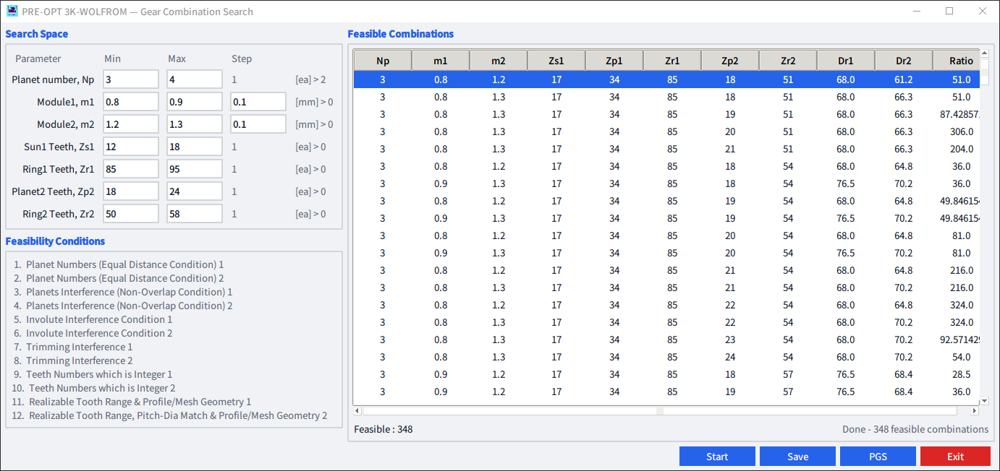
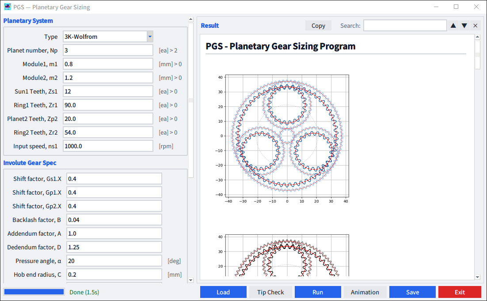
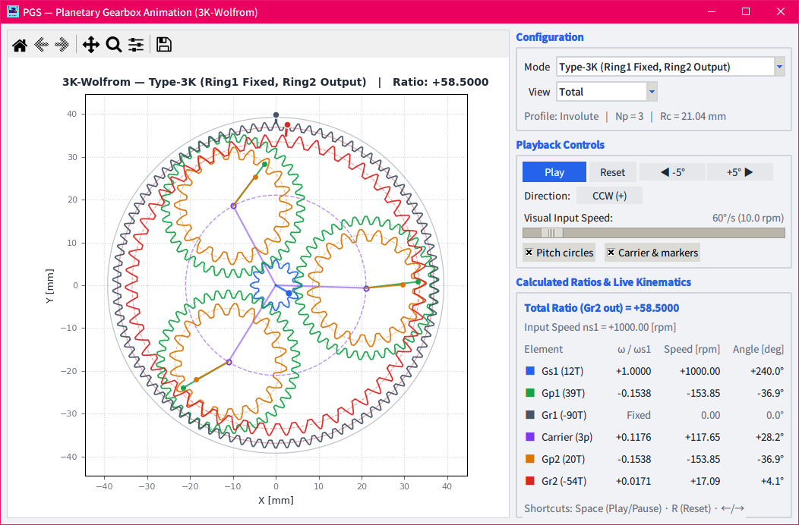
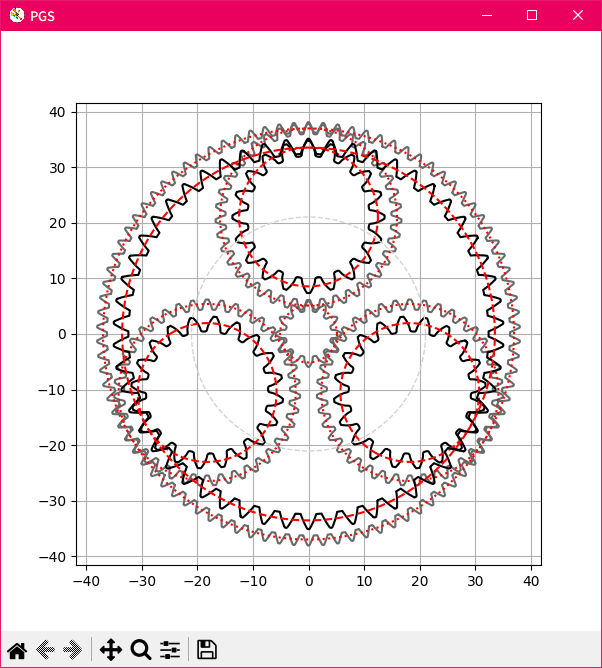
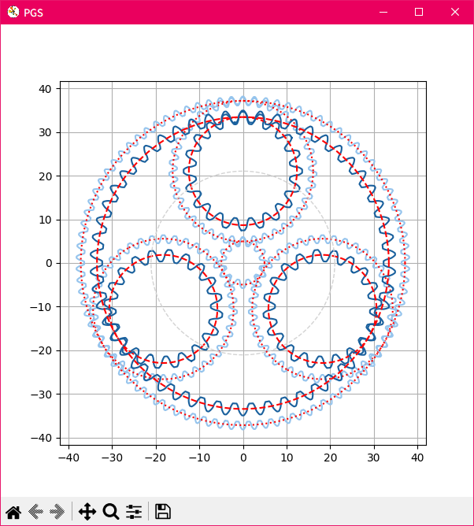
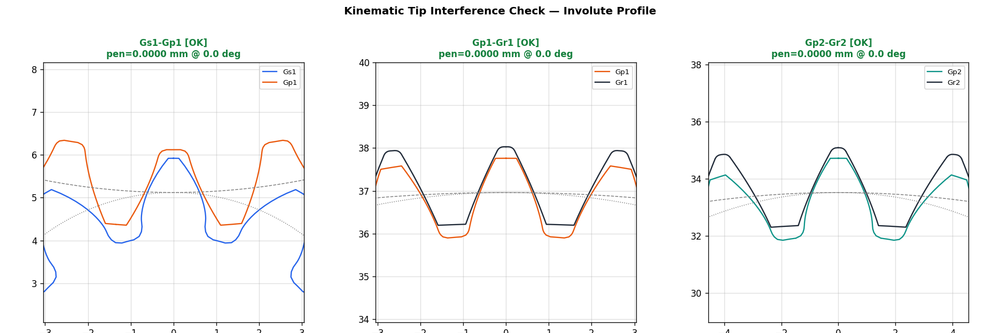

# PGS

_유성기어장치 치수 결정 도구 (Simple & Wolfrom)_

Simple 및 Wolfrom형 유성기어장치의 기어비, 운전 속도, 예상 효율 및 역구동성(치면 물림, 베어링, 실, 속도 연동 교반 손실), 기어 치수, 기하학적 및 운동학적 이끝 간섭 검사를 계산합니다. Python으로 작성되었으며 스크롤 가능한 파라미터 사이드바를 갖춘 ttk 기반 그래픽 인터페이스를 제공합니다.

* [MANUAL_KO.md](MANUAL_KO.md) ([English Manual](MANUAL.md))
* [English README](README.md)

## 기어 종류 (Gear Types)

| 타입 | 코드 | 설명 |
|------|------|------|
| Simple | 0 | 표준 단단(Single-Stage) 유성기어장치 |
| 3K-Wolfrom | 1 | Wolfrom 유성기어장치; 두 링기어 잇수(`Ring1 Teeth, Zr1` 및 `Ring2 Teeth, Zr2`)를 UI에서 독립 입력으로 직접 지정하며, 기어비와 2단 물림 전위가 이로부터 자동 도출됨 |

## 기어 계통 구조 (Gear Set Architecture)

모델은 2개 단에 배치된 총 6개의 기어로 구성됩니다.

| 기어 | 설명 |
|------|------|
| Gs1 | 1단 태양기어 (Sun gear, stage 1) |
| Gp1 | 1단 유성기어 (Planet gear, stage 1) |
| Gr1 | 1단 링기어 (Ring gear, stage 1) |
| Gs2 | 2단 태양기어 (Sun gear, stage 2) |
| Gp2 | 2단 유성기어 (Planet gear, stage 2) |
| Gr2 | 2단 링기어 (Ring gear, stage 2) |

## 기하학적 검사 (Geometric Checks)

1단(공유 캐리어) 기어 세트에 대해 다음 타당성 검사를 수행합니다.

- 연속 물림 조건 (Non-factorizing / sequential mesh condition)
- 등간 배치 조건 (Equal distance condition / planet spacing)
- 유성기어 상호 간섭 (Planets interference / non-overlap condition)
- 인볼루트 간섭 (Involute interference)
- 트리밍 간섭 (Trimming interference)
- 정수 잇수 조건 (Integer tooth numbers)
- **운동학적 이끝 간섭 검사 (1피치 회전 스윕)** — **Involute** (`GPG`)와 **Cycloid** (`CPG`) 치형 모두에 대해 `Gs1-Gp1`, `Gp1-Gr1`, `Gp2-Gr2`(Wolfrom) 물림쌍 및 유성기어 상호 이끝 틈새(1단·2단)를 동일하게 검사하며, 통과/실패 여부, 최대 침투 깊이 [mm], 최악 위상각 [deg]을 보고합니다.

## 사전 요구 사항 (Prerequisites)

- [uv](https://docs.astral.sh/uv/) 패키지 관리자

## 설치 (Installation)

```bash
git clone https://codeberg.org/dymaxionkim/PGS.git
cd PGS
uv sync
```

## 사용법 (Usage)

GUI 실행:

```bash
uv run design.py
```

명령줄 인자로 Markdown 보고서 경로를 넘기면 시작 시 `## Input Parameters` 섹션을 자동으로 불러와(**Load** 버튼과 동일) 해당 설계를 즉시 계산합니다.

```bash
uv run design.py Result/README.md
```

또는 OS별 런처 스크립트를 사용할 수 있습니다.

- MS Windows: `PGS.bat`
- Linux: `./PGS.sh`

### 사전 최적화 탐색 도구 (PRE-OPT_3K-WOLFROM)

`design.py`로 단일 조합을 상세 설계하기 전에, 사전 탐색 도구를 사용하여 3K-Wolfrom 파라미터 공간을 스캔하고 기하학적으로 성립 가능한 모든 잇수/모듈 조합을 표로 나열할 수 있습니다.

```bash
uv run PRE-OPT_3K-WOLFROM.py   # 또는 PRE-OPT_3K-WOLFROM.bat / .sh
```



- **Search Space** — 독립 입력(min/max/step)을 `Np`, `m1`, `m2`, `Zs1`, `Zr1`, `Zp2`, `Zr2` 순서로 지정합니다. 정수 파라미터는 1씩 증가하며 모듈(`m1`, `m2`)만 Step 열을 가집니다. 기본값: m1 0.8–0.9 (step 0.1), m2 1.2–1.3 (step 0.1), Np 3–4, Zr2 50–58, Zp2 18–24, Zr1 85–95, Zs1 12–18.
- **Start** — 탐색을 실행하고 테이블만 채웁니다(폴더 선택창이나 파일 저장 없음). 두 개의 전처리 테이블을 사용해 고속으로 12개 검사(1단·2단 해석적 검사 10종 + 1단·2단 실성립 잇수 범위, 공유 캐리어 피치원 정합, 운용 압력각, 정면 물림률, 이끝-이뿌리 틈새, 비꼬임 인볼루트 치형 검사 및 특이 감속비 `l2 = 1` 제외)를 평가합니다.
- **Save** (Start 바로 오른쪽) — 폴더를 선택해 현재 테이블을 `Result.xlsx`로 저장합니다. 저장할 결과가 없으면 경고하며, Excel 최대 행 수(1,048,576)를 초과하면 저장을 거부합니다.
- **PGS** (Save 오른쪽) — 테이블에서 정확히 1개 행이 선택된 경우에만 활성화되며, 해당 행의 파라미터를 미리 채운 상태로 `design.py`를 실행합니다(임시 보고서를 기록한 뒤 `python design.py <report>` 실행).
- **테이블 열** — `Np, m1, m2, Zs1, Zp1, Zr1, Zp2, Zr2, Dr1, Dr2, Ratio` (`Dr1 = m1·|Zr1|`, `Dr2 = m2·|Zr2|`, `Ratio`는 Type-3K 전체 감속비 `g22`). `Zp1 = (|Zr1| − Zs1)/2`는 등거리 조건에 의해 자동 결정됩니다.

### 입력 파라미터 (Input Parameters)

좌측 사이드바는 마우스 휠 스크롤을 지원하는 4개의 세로 스크롤 카드(**Planetary System**, **Involute Gear Spec**, **Loss Parameters**, **Plot**)로 파라미터를 구성합니다. GUI는 전체 스택 높이의 약 70% 수준의 컴팩트한 기본 높이로 열리며 스크롤로 모든 입력 항목에 접근할 수 있습니다.



| 파라미터 | 설명 |
|-----------|------|
| Type | 위 표의 기어박스 타입 선택 |
| Planet number, Np | 유성기어 개수 [ea], > 2 |
| Module1, m1 | 1단 기어 모듈 [mm], > 0 |
| Module2, m2 | 2단 기어 모듈 [mm], > 0 |
| Sun1 Teeth, Zs1 | 1단 태양기어 잇수 [ea], > 0; 기어비 결정 |
| Ring1 Teeth, Zr1 | 1단 링기어 잇수 [ea], > 0; Simple과 3K-Wolfrom 모두 독립 입력 |
| Planet2 Teeth, Zp2 | 2단 유성기어 잇수 [ea], > 0 (3K-Wolfrom 전용); 1단 캐리어 반경 위에 배치 |
| Ring2 Teeth, Zr2 | 2단 링기어 잇수 [ea], > 0 (3K-Wolfrom 전용); Zp2 바로 아래 입력. Zr1, Zp2, Zs1, m1, m2와 함께 기어비와 2단 물림을 결정(두 링 잇수로 감속비 조정). 2단 태양기어 `Zs2 = (dc − dp2)/m2`는 공유 캐리어 반경으로부터 도출되며 비정수일 수 있음 |
| Input speed, ns1 | 1단 태양기어 Gs1의 입력 회전속도 [rpm]; Speed 블록의 운전 속도 및 Efficiency & Backdrivability의 속도 연동 교반 손실 계산에 사용 |
| Shift factor, Gs1.X | 1단 태양기어 전위계수 |
| Shift factor, Gp1.X | 1단 유성기어 전위계수; Gs1.X와 함께 캐리어 반경을 결정 |
| Shift factor, Gp2.X | 2단 유성기어 전위계수 |
| Backlash factor, B | 백래시 보정 계수 |
| Addendum factor, A | 이끝높이(어덴덤) 계수 |
| Dedendum factor, D | 이뿌리깊이(디덴덤) 계수 |
| Pressure angle, α | 압력각 [deg] (기본 20°) |
| Hob end radius, C | 호브 선단 반경 [mm] |
| Tooth end radius, E | 이끝 라운드 반경 [mm] |
| Friction coeff, μ | 치면 미끄럼 마찰계수; 편집 가능한 콤보박스 프리셋 `0.08 (Grease)`(기본), `0.05 (Oil)` 또는 0 이상 임의 수치 입력 |
| Input bearing, μb_in | 입력축(Gs1) 지지 베어링 마찰계수(기하 계수 `k_in = d_in / ds1`); 프리셋 `0.002 (Ball)`(기본), `0.005 (Roller)`, `0.05 (Bushing)`, `0.0 (Floating/None)` 또는 직접 입력 |
| Planet bearing, μb_p | 캐리어 동력 순환 루프 내부의 유성 핀 베어링 마찰계수(`d_pin / dp`); 프리셋 `0.002 (Ball/Needle)`(기본), `0.005 (Roller)`, `0.05 (Bushing)`, `0.0 (None)` 또는 직접 입력 |
| Carrier bearing, μb_c | Wolfrom Type-3K 자유 회전 캐리어 지지 베어링 마찰계수(`k_c = dc / (ds1 + dr1)`); Simple 모드에서 비활성, Carrier Fixed 시 0, Carrier Output 시 Output Shaft Bearing에 통합되어 이중 계상 방지; 프리셋 `0.002 (Ball)`(기본), `0.005 (Roller)`, `0.05 (Bushing)`, `0.0 (Floating/None)` 또는 직접 입력 |
| Output bearing, μb_out | 출력축/하우징 베어링 마찰계수(기하 계수: Ring 출력 시 `k_out = (dr_out + 4·m_out) / dr_out`, Carrier 출력 시 `k_out = 0.5·(ds1 + dc) / dc`로 이중 계상 없이 1회 적용); 프리셋 `0.005 (Crossed Roller)`(기본), `0.002 (Ball)`, `0.01 (Preloaded CRB)`, `0.05 (Bushing)`, `0.0 (None)` 또는 직접 입력 |
| Seal loss, ζs | 부하 비의존 축 실(Seal) 마찰 손실 비율; 프리셋 `0.0 (None)`(기본), `0.005 (Low-fric)`, `0.01 (Lip seal)`, `0.02 (Double-lip)` 또는 직접 입력 |
| Churning coeff, kc | 기준 속도 `1000 rpm`에서의 교반(Churning)/풍손 계수 — 입력 속도 `ns1`의 제곱에 비례(`kc · (|ns1| / 1000)²`); 프리셋 `0.005 (Grease)`(기본), `0.015 (Oil splash)`, `0.002 (Oil mist)`, `0.0 (None)` 또는 직접 입력 |
| Plot option | 인터랙티브 프리뷰 범위: `Stage1` / `Stage2` / `Total` 또는 단일 기어 `Gs1`, `Gp1`, `Gr1`(1단), `Gp2`, `Gr2`(2단) — 선택한 구성만 그림. Simple에서는 1단 옵션만 제공. 저장되는 이미지는 항상 적용 가능한 모든 범위를 포함("결과 파일" 참조) |
| Teeth profile | `Involute Teeth` (GPG) / `Cycloid Teeth` (CPG) 또는 두 치형을 한 도면에 겹쳐 그리는 **`All`** (인볼루트 회색/검정, 사이클로이드 파랑) |

### Run, Animation, Tip Check, Load & Save

- **Run** — 기어박스를 계산하고 빠른 실행을 위해 프로젝트의 `result/` 디렉토리에 `README.md`와 링크된 요약 도면 2종(3K-Wolfrom: `Involute_Total.png`·`Cycloid_Total.png`, Simple: `Involute_Stage1.png`·`Cycloid_Stage1.png`)만 저장한 뒤, Result 패널에 렌더링된 Markdown 보고서(인라인 이미지 포함)를 표시하고 비차단(non-blocking) 방식으로 인터랙티브 플롯 프리뷰를 엽니다(완료 즉시 버튼 재활성화). 하단 좌측 진행률 바에 단계별 진행 상황과 경과 시간이 실시간으로 표시됩니다. 활성 치형 중 운동학적 1피치 이끝 간섭 검사에서 `Fail`이 발생하면 간섭 지점이 빨간 점으로 표시된 최악 위상 확대 검사 창이 자동으로 함께 열립니다.
- **Animation** (**Run** 바로 오른쪽) — 계산된 정확한 속도비에 따라 기어박스의 모든 요소(`Gs1`, `Gp1`, `Gr1`, `Carrier`, 3K-Wolfrom의 `Gp2`·`Gr2`)를 실시간으로 애니메이션하는 팝업 창(`animation.py`)을 엽니다. 구속 모드 전환, 스테이지 필터(`Total` / `Stage1` / `Stage2`), 활성 치형(`Involute` / `Cycloid` / `All`), 재생/일시정지(`Space`), 초기화(`R`), `±5°` 스텝(`←`/`→`), 회전 방향 전환, 시각적 입력 속도 슬라이더, 피치원·캐리어/마커 토글, 줌/팬 툴바, 실시간 속도비·RPM·회전각 테이블을 지원합니다.
- **Tip Check** — 계산을 실행하고 모든 검사가 통과(`OK`)한 경우에도 현재 활성화된 모든 프로파일(`Involute`, `Cycloid`, 또는 `All` 선택 시 둘 다)의 최악 위상 확대 이끝 간섭 검사 창을 즉시 엽니다.
- **Load** — 저장된 `README.md` 파일(예: `Result/README.md`)을 선택하면 `## Input Parameters` 섹션을 읽어 입력 위젯을 자동으로 다시 채우고(보고서에 음수로 저장된 링 잇수는 양수로 자동 변환되며, 단일 `mu_b`만 기록된 구버전 보고서도 4개 베어링 입력에 자동 반영됨) **Run**과 동일하게 계산을 실행합니다. 저장된 설계를 다시 열어 수정할 때 사용하며, 명령줄 인자로 보고서 경로를 넘길 때(`uv run design.py Result/README.md`)도 동일한 자동 입력이 수행됩니다.
- **Save** — 계산을 재실행하고 폴더 선택 대화상자로 지정한 경로 아래에 `Result` 디렉토리를 생성하여 `Result/README.md`, `model.csv`, 전체 도면(`Involute_*`/`Cycloid_*`/`All_*`/`TipCheck_*`), 기어별 FGPG2 하위 폴더를 포함한 모든 결과 파일을 저장하며, 하단 진행률 바에 진행 상황과 경과 시간을 표시합니다.



### 명령줄 실행 (헤드리스 CLI)

`PGS_CLI.py`를 사용하면 GUI 없이 저장된 설계를 재실행할 수 있습니다. Markdown 보고서의 `## Input Parameters` 섹션을 읽어 **Run**과 동일한 계산을 수행하고 입력 파일과 같은 폴더에 모든 결과 파일을 내보냅니다.

```bash
uv run PGS_CLI.py <README.md> [SaveAll|SaveOK|SaveMD]
```

- `<README.md>` — `## Input Parameters` 섹션을 포함한 Markdown 파일 경로(예: `Result/README.md`).
- `SaveAll` (생략 시 기본값) — 보고서 `README.md`, `Involute_*`/`Cycloid_*`/`All_*.png`, `TipCheck_*.png` 도면, 기어별 폴더(`Gs1`/`Gp1`/`Gr1`[`/Gp2`/`Gr2`] 내부 `Involute`/`Cycloid` 포함)를 GUI **Save**와 동일한 구조로 **입력 파일과 같은 폴더**에 저장합니다.
- `SaveOK` — 재생성된 `## Check Geometrical Conditions`에 `Fail` 상태가 하나라도 있으면 아무 파일도 저장하지 않습니다.
- `SaveMD` — `SaveOK`와 같이 `Fail`이 있으면 아무것도 저장하지 않으며, 모든 검사가 `OK`인 경우 **보고서 `README.md` 파일만** 저장합니다(도면·기어별 폴더 제외).

참고: 출력 보고서는 입력 파일이 위치한 폴더에 `README.md` 이름으로 저장되므로, 입력 파일 자체가 `README.md`인 경우 재생성된 보고서로 덮어쓰여집니다.

### 결과 파일 (Result files)

**Run** 실행 시에는 빠른 반복 설계를 위해 프로젝트의 `result/` 폴더에 `README.md`와 링크된 요약 도면 2종(3K-Wolfrom: `Involute_Total.png`·`Cycloid_Total.png`, Simple: `Involute_Stage1.png`·`Cycloid_Stage1.png`)만 저장됩니다.

**Save** (또는 `PGS_CLI.py ... SaveAll`)로 생성되는 전체 `Result/` 폴더의 구성은 다음과 같습니다.

```
Result/
├─ README.md                  ← Result 패널에 표시되는 보고서 원본 Markdown
├─ model.csv                  ← 기어박스 전체 입력 모델 테이블
├─ Involute_*.png / Cycloid_*.png / All_*.png   ← 치형 도면 (아래 참조)
├─ TipCheck_Involute.png / TipCheck_Cycloid.png ← 최악 위상 확대 이끝 간섭 검사 도면
└─ Gs1/ Gp1/ Gr1/ [Gp2/ Gr2/] ← 내보내기 대상 기어별 폴더 (Gs2는 내보내지 않음)
   ├─ Inputs.csv
   ├─ Involute/               ← Inputs.csv + Result.csv + Result.dxf + Result1.png + Result2.png
   └─ Cycloid/                ← 사이클로이드 프로파일에 대한 동일 5종 파일
```

기어박스 타입별 도면 파일명:

- **3K-Wolfrom**: `Total`, `Stage1`, `Stage2`, `Gs1`, `Gp1`, `Gr1`, `Gp2`, `Gr2`에 대한 `Involute_*` / `Cycloid_*`, 그리고 `Total` 및 각 기어에 대한 겹침 도면 `All_*`.
- **Simple**: `Stage1`, `Gs1`, `Gp1`, `Gr1`에 대한 `Involute_*` / `Cycloid_*`, 그리고 `Stage1` 및 각 기어에 대한 겹침 도면 `All_*`.

기어별 `Involute/` 및 `Cycloid/` 하위 폴더는 내장된 FGPG2 기어 생성기(`fgpg2/` 패키지 + `FGPG2_CLI.py`)가 각 치형에 맞춰 생성하며, `All_*` 이미지는 두 치형을 겹쳐 표시합니다.

링기어 전위계수(`Gr1.X`, `Gr2.X`)는 직접 입력하지 않으며, 입력된 전위계수(`Gs1.X`, `Gp1.X`, `Gp2.X`)를 반영해 캐리어 반경에서 유성기어와 링기어가 치면 틈새 없이(무백래시) 맞물리도록 자동 계산됩니다. 백래시 `B = 0`이면 어떤 전위 조합에서도 치면 간극이 발생하지 않으며, `B` 입력값은 그 위에 의도된 플랭크 여유로 더해집니다.

링기어 잇수는 직접 입력되며 정수로 유지됩니다(필요 시 반올림). 1단 유성기어 잇수는 등거리 조건(`Zp1 = (|Zr1| − Zs1)/2`)으로 결정되며, 공유 캐리어 반경에 대한 2단 물림 편차는 자동 산출된 링 전위계수(`Gr1.X`, `Gr2.X`)가 흡수합니다.

### 사이클로이드 치형 (Cycloidal teeth)

**Cycloid Teeth**를 선택하면 외사이클로이드/내사이클로이드 플랭크를 갖는 치형(`CPG.py`, `GPG`와 동일 인터페이스)이 생성됩니다. 각 단은 캐리어 중심거리 `dc/2`를 잇수 비로 분할(`m_w1 = dc/(Zs1+Zp1)`, `m_w2 = dc/(|Zr2|−Zp2)`)하여 맞물리는 기어들이 단일 운용 원주 피치 `π·m_w`와 치두께 `(π/2 − B)·m_w`를 공유하도록 함으로써, `B = 0`일 때 전위로 인한 치면 틈새를 방지합니다. **All**을 선택하면 인볼루트와 사이클로이드 치형을 하나의 도면에 겹쳐 직접 비교할 수 있습니다.

> 제한 사항: 사이클로이드 치형은 정수 잇수가 필요합니다. Wolfrom 구성에서는 2단 태양기어 `Zs2`가 비정수(예: 15.0667)가 될 수 있습니다. **Save** / **Run** 저장 시 해당 `Cycloid_*` / `All_*` / `TipCheck_Cycloid.png` 이미지는 콘솔에 `WARN` 메시지를 남기고 건너뛰며, 모든 인볼루트 이미지·보고서·기어별 FGPG2 결과는 정상 저장됩니다. 프리뷰에서 `Cycloid Teeth` / `All`을 선택한 경우 치형 생성 단계에서 예외가 발생할 수 있으므로, `Involute Teeth`를 사용하거나 `Zs2`가 정수가 되도록 `Zs1`, `Np`, `Zr1`, `Zr2`, `Zp2`를 조정하세요.

 



### 출력 (Output)

**Result** 패널은 저장된 보고서를 Markdown 문법으로 렌더링하여 표시하며, 상단 헤더 우측에 **원본 Markdown 복사 버튼(`Copy`)**과 **키워드 검색창(`Search:`, `Ctrl+F` 포커스)**을 제공합니다. 검색어 입력 시 대소문자를 구분하지 않고 실시간 하이라이트와 매치 카운터(`1/N`)가 표시되며, `Enter` / `▼`와 `Shift+Enter` / `▲`로 자동 스크롤 이동, `Esc` / `×`로 검색을 초기화할 수 있습니다. 패널에 표시되는 항목은 다음과 같습니다.

- **Ratio** — 각 단 및 전체 기어비 (캐리어 고정 / 링 고정 / 3K 타입)
- **Speed** — 입력 태양기어(Gs1), 캐리어, 두 링기어(Gr1, Gr2), 복합 유성기어(Gp1, Gp2)의 운전 속도 [rpm]. Wolfrom의 3가지 구속 구성(Type-3K 링1 고정 / 링2 고정·캐리어 출력 / 캐리어 고정·링2 출력) 또는 Simple의 2가지 구속 구성(캐리어 고정·링1 출력 / 링1 고정·캐리어 출력)별로 출력되며, 모든 값은 `Gs1` 입력 방향 대비 `+/-` 부호를 명시합니다.
- **Efficiency & Backdrivability** — **치면 물림, 베어링, 실, 속도 연동 교반 손실**을 통합하여 모든 구속 구성(Simple은 1·2·3단 직렬 효율 포함)에 대해 추정 총 효율과 역구동성을 stdout 및 Result 보고서(`README.md`)에 출력합니다.
  - **Mesh Efficiency & Contact Ratio** — 인볼루트 치형 기하, 운용 압력각, 정면 물림률 및 치면 마찰계수 `μ`로부터 계산한 물림쌍별 미끄럼 효율(`Gs1-Gp1`, `Gp1-Gr1`, Wolfrom의 `Gp2-Gr2`)
  - **Bearing Loss** — 기하 기반 레버리지 계수 `k`를 적용한 4개 분리 베어링 그룹: **Input Shaft** (`μb_in`), **Planet Pin** (`μb_p`, 캐리어 동력 순환 루프 내부), **Carrier** (`μb_c`, Wolfrom Type-3K 자유 회전 캐리어 전용), **Output Shaft** (`μb_out`, Ring 출력 vs. Carrier 출력 이중 계상 없이 1회 적용)
  - **Parasitic Losses (Seal & Churning)** — 부하 비의존 실 손실 `ζs` 및 입력 속도 `ns1`에 직접 연동되는 교반 손실 `kc · (|ns1| / 1000)²` (참조 태양기어 피치선속도 `vt_s1` [m/s] 포함; 다단 Simple에서는 후단 교반 손실을 단별 `1 / ratio²`로 감쇠)
  - **Forward / Reverse Efficiency** — `Mesh+Bearing` 및 `Parasitic` 분해 내역과 함께 정구동($\eta_F$)·역구동($\eta_R$) 총 효율 [%]을 제공하며, Type-3K Wolfrom의 내부 순환 동력 손실을 반영
  - **Backdrivability Assessment (3-Tier)** — 공학적 상세 등급: `Good` ($\eta_R \ge 20\%$, 원활한 역구동), `Marginal` ($0\% < \eta_R < 20\%$, 이론상 가능하나 정지마찰·저항 변동에 민감), `Self-Locking` ($\eta_R \le 0\%$, 통합 손실로 인해 역구동 불가) 및 Type-3K Wolfrom의 임계 자가잠금 마찰계수 `μ_lock`(베어링·실·교반 손실 포함)
  - **Backdrivable (Conclusion)** — 명확한 2단계 판정: `Possible` ($\eta_R > 0$) 또는 `Not Possible` ($\eta_R \le 0$)
- **Size** — 6개 기어(Simple은 1단 3개)의 피치원 직경 및 잇수
- **Checks** — 1단 해석적 타당성 검사 6종 및 모든 물림쌍·유성기어 간 틈새에 대한 운동학적 1피치 이끝 간섭 검사(`Involute`, `Cycloid`, 또는 둘 다)의 통과/실패 결과

## 파일 구성 (Files)

| 파일 | 역할 |
|------|------|
| `design.py` | GUI 진입점 (ttk 테마, 레이아웃, 진행률·소요시간 상태바, 이벤트 핸들러, 비차단 matplotlib 도면, Markdown 렌더링 및 보고서/CSV 출력) |
| `animation.py` | 인터랙티브 2D 유성기어박스 애니메이션 팝업 — 계산된 정확한 속도비로 모든 기어 요소를 애니메이션하며 구동 모드·스테이지 전환, 재생 제어, 실시간 기구학 테이블 제공 |
| `PGS.py` | 유성기어장치 치수 및 효율·역구동성 계산 로직 |
| `GPG.py` | 범용 인볼루트 치형 생성기 (외치/내치 공용) |
| `CPG.py` | 사이클로이드 치형 생성기 (`GPG`와 동일 인터페이스의 교체 모듈) |
| `interference.py` | 운동학적 1피치 회전 스윕 이끝 간섭 검증기 및 최악 위상 확대 도면기 (Involute·Cycloid 공용) |
| `FGPG2_CLI.py` | 내장 FGPG2 CLI 진입점 (`FGPG2_CLI.py <Inputs.csv> [involute\|cycloid]`) — 기어별 Result 파일 재생성 |
| `PGS_CLI.py` | 헤드리스 CLI 실행기 (`PGS_CLI.py <README.md> [SaveAll\|SaveOK\|SaveMD]`) — 보고서의 `## Input Parameters`로부터 **Run**과 동일한 계산을 수행하고 같은 위치에 파일 내보내기 |
| `fgpg2/` | 이식된 FGPG2 생성기 패키지 (`gear.py`, `cycloid.py`, `exporters.py`, `plotter.py`) — 인프로세스로 `Result.csv` / `Result.dxf` / `Result1.png` / `Result2.png` 생성 |
| `PGS.bat` / `PGS.sh` | OS별 실행 스크립트 |
| `PRE-OPT_3K-WOLFROM.py` | 사전 최적화 탐색 GUI — 3K-Wolfrom 파라미터 공간을 스캔하여 성립 가능한 잇수/모듈 조합을 표로 나열하고 `Result.xlsx` 내보내기 및 선택 조합을 `design.py`로 실행 |
| `PRE-OPT_3K-WOLFROM.bat` / `PRE-OPT_3K-WOLFROM.sh` | 사전 최적화 탐색 런처 스크립트 |

## 감사합니다!
